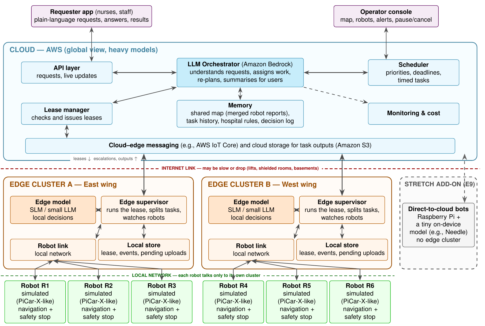
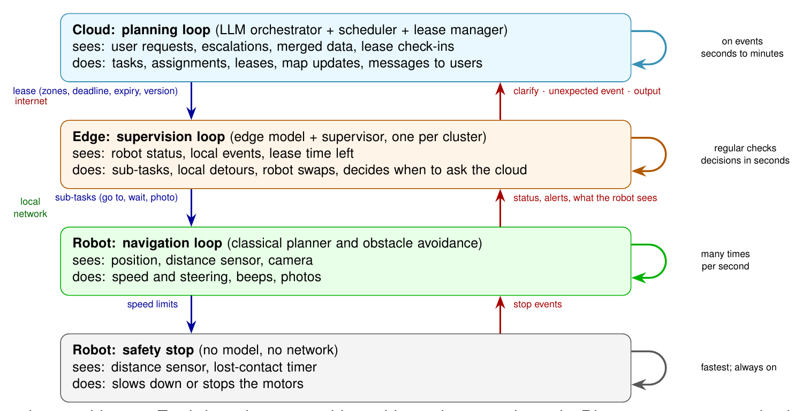
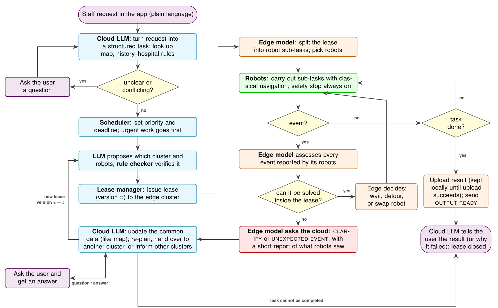
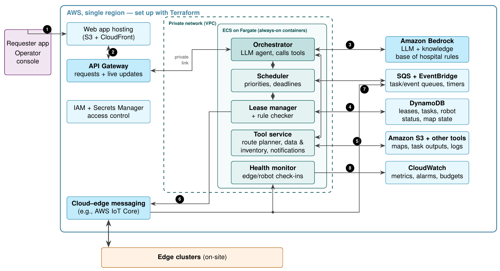

# Nimbus: LLM-Orchestrated Robot Fleets with Leased Authority across Cloud and Edge

**Product Requirements Document, version 5.0 (the original plan).** This is the plan of record, transcribed from
[docs/PRD_v5.pdf](docs/PRD_v5.pdf) with its figures unchanged. Later status updates are in
[docs/PRD_v6.md](docs/PRD_v6.md); measured results are linked from [README.md](README.md#7-experiments-and-results).

---

## 0. Title block

| | |
| --- | --- |
| **Team** | Team Nimbus, DS252 Introduction to Cloud Computing (Aug to Nov 2026), IISc: Kautuk Astu, M Vaibhav, Garrepally Akshaya, C Veera Sai Charan Teja |
| **Summary** | A cloud LLM issues time-limited leases to edge-cluster SLMs that run hospital delivery robots locally, escalating only for clarification, unexpected events, or finished results. |
| **Date / version** | 26 Sep 2026, v5.0 |

## 1. Problem statement and motivation

Every day a hospital moves hundreds of infusion pumps, monitors, IV poles and wheelchairs between stores, wards and
theatres. Staff ask for these things informally ("a paediatric pump to 2B, bed 12, soon"), often leaving out details.
The building changes all the time: corridors get blocked, doors close, wards are declared infectious, and patients are
moved. Robots help most in exactly the places where staff exposure should be minimised: infectious wards, isolation
rooms and patients in isolation. Robots can take equipment, supplies and specimens in and out without a person
entering. Today's hospital delivery robots, such as Aethon TUG [16], mostly follow pre-set routes with a fixed menu of
jobs. They do not interpret free-form requests, combine what several robots see, or re-assign work across the fleet
when plans change. Their network connection is also unreliable: coverage drops in lifts, stairwells, shielded imaging
rooms and basements.

**Why this cannot run on one machine.** Requests arrive from every wing at once and must be answered against a single,
constantly changing shared picture of the building, which argues for a central service rather than one machine per
ward. At the same time, the link from any one wing to that central service can drop for minutes at a time, and the
language model capable enough to handle open-ended requests is too large to run on site. So the reasoning has to be
split across a cloud tier (global view, heavy model) and an on-site edge tier (local autonomy through outages), not
concentrated on either a single on-site box or a single cloud service.

We propose a cluster-based fleet in three tiers (Sec. 6):

- a cloud LLM orchestrator that talks to staff and hands work to edge clusters as leases
- one edge cluster per wing whose small model always runs the robots under it
- robots with classical navigation and a model-free safety stop

Other settings with the same structure:

- **Disaster response:** some robots map a partly collapsed building while others search for survivors, over an
  intermittent link. This is the same merge-and-re-assign loop as the hospital.
- **Mining:** coverage can be absent entirely, so bounded local authority is the only option.
- **Space:** round-trip delay can reach several minutes (Mars), with the same consequence.

We list these as future applications, not concurrent primary scope.

## 2. Scope: in scope, out of scope, assumptions

**In scope:**

- the cloud-edge-robot architecture and lease protocol (Sec. 6)
- a cloud LLM orchestrator on Amazon Bedrock
- an edge SLM per cluster that always supervises its robots
- classical robot navigation and a model-free safety stop
- a requester app and an operator console
- three evaluation configurations, C1, C2 and C3 (Sec. 7)
- trace-driven network and workload replay
- simulation in Gazebo with an open hospital world and several simulated PiCar-X-like robots

**Out of scope:**

- clinical decision-making
- real patient data (synthetic data only)
- new mapping or SLAM methods (the building map is given)
- physical loading of items onto a robot
- physical PiCar-X hardware, which is a stretch goal only, never a promised deliverable

The optional "direct-to-cloud" path (a Raspberry Pi with a tiny on-device model such as Needle, bypassing the edge
cluster) is explicitly out of the core system. It is evaluated, if at all, only as the separate stretch experiment E9
(Sec. 7), and is never part of configuration C1.

**Assumptions:**

- **Edge hardware:** one lab workstation per cluster, minimum an NVIDIA RTX 3060-class GPU (12 GB), or failing that a
  Jetson AGX Orin (32 GB).
- **Edge model:** a 1 to 3B instruct model (candidates: Qwen2.5-1.5B or Llama-3.2-3B), 4-bit quantised, served with
  llama.cpp, with output capped at 150 tokens per decision. The exact model is fixed by experiment E1 before
  Milestone 1, and every downstream latency target (Sec. 5) is measured on this pinned configuration.
- **Cloud:** AWS, single region, set up with Terraform.
- **Static inputs:** the hospital building map and hospital rule documents are given, not produced by our system.

## 3. Stakeholders and usage scenarios

**User roles:**

- **Ward staff and nurses (requesters):** send plain-language requests, answer clarifying questions, and see status and
  results through the requester app.
- **Hospital operator:** watches the map, robots and leases, and can pause or cancel through the operator console.
- **Cloud orchestrator and edge cluster:** autonomous system roles that plan, lease and supervise. They are not human
  stakeholders, but they are the parties every requirement in Sec. 4 is written against.

The functional requirements in Sec. 4 are derived from three scenarios:

- **SC-1 (vague urgent request).** "Need an infusion pump at 2B-12, urgent." The cloud LLM knows 2B-12 is a paediatric
  bed and asks whether a paediatric pump is meant. It then leases the task, with a 12-minute deadline, to the
  East-wing cluster. Drives FR-4, FR-13, FR-21.
- **SC-2 (unexpected event, fleet re-plan).** A corridor is blocked and then a gate into the West wing closes. The edge
  parks the robot and reports. The cloud updates the shared map, warns the affected cluster, and re-assigns the last
  leg under a new lease version. Drives FR-5, FR-6, FR-9, FR-16.
- **SC-3 (infectious ward).** "Ward 2C is now isolation. Get the spare pumps out, hold routine deliveries there, urgent
  ones can still go in." The cloud re-prioritises, sends robots (not staff) to move pumps out of 2C, and informs the
  ward and the operator. Drives FR-13, FR-14, FR-17.

Three further scenarios follow the same pattern and are used only in the evaluation task suite (Table 3):

- a local detour handled entirely at the edge (no cloud call)
- several robots surveying equipment and merging their reports
- a cluster that goes offline in a basement corridor and catches up on reconnection

## 4. Functional requirements

All tests run in simulation, and on physical robots only if that extra scope happens (Sec. 8). Every requirement is
validated by at least one experiment in Sec. 7 (Table 4).

### 4.1 Edge and robot control

| ID | Priority | Requirement | Acceptance criterion |
| --- | --- | --- | --- |
| FR-1 | Must | Safety stop: a robot stops when an obstacle is too close, without edge or cloud. | 30 trials with the network cut: every robot stops. |
| FR-2 | Must | Navigation: robots follow routes and avoid moving obstacles with a classical planner. | 10 runs with moving obstacles: at least 90% of trips without collision. |
| FR-3 | Must | Edge supervision: the edge model splits each lease into robot sub-tasks, assigns robots and monitors them. | At least 95% of edge decisions use an allowed action; otherwise the robot waits and the cloud is asked. |
| FR-4 | Must | Handle locally or ask: solve events the lease allows; otherwise send CLARIFY or UNEXPECTED_EVENT. | 40 hand-labelled situations: at least 80% handled correctly. |
| FR-5 | Must | Stay within the lease: nothing outside allowed zones, after expiry, or from an outdated lease version. | No violations in any run. |
| FR-6 | Must | Keep working through outages: continue the current lease and hold messages; after expiry, park robots in safe spots. | With recorded outages: held messages delivered after reconnecting; no robot left in a doorway or lift. |
| FR-7 | Should | Edge node takeover: if one edge node fails, another in the cluster takes over its robots. | Node shut down mid-task: takeover within about 30 s; no step done twice. |

### 4.2 Cloud-edge communication

| ID | Priority | Requirement | Acceptance criterion |
| --- | --- | --- | --- |
| FR-8 | Must | No duplicate actions: every message has an ID and lease version; repeated or outdated ones are ignored. | Repeated, re-ordered and outdated messages injected: no step executed twice. |
| FR-9 | Must | Three escalation types (CLARIFY, UNEXPECTED_EVENT, OUTPUT_READY), each a short structured message. | All escalations follow the format. |
| FR-10 | Must | Results are never lost: kept at the edge until safely uploaded. | Outages of up to 10 min: every result arrives. |
| FR-11 | Should | Selective sharing: updates go only to affected clusters and people. | Every affected cluster is informed; few unaffected ones. |
| FR-12 | Must | Reconnection: after an outage the edge sends a summary; the cloud reconciles and renews or replaces leases. | Within about 1 min; no robot under two leases at once. |

### 4.3 Planning, orchestration and lease allocation (cloud)

| ID | Priority | Requirement | Acceptance criterion |
| --- | --- | --- | --- |
| FR-13 | Must | Understand requests: turn text into a structured task (item, from, to, priority, deadline); ask when unsure. | 50 requests, a quarter of them vague: at least 85% of details right; most vague ones get a question. |
| FR-14 | Must | Scheduling: priority levels and deadlines; urgent work goes first; timed tasks supported. | An urgent task never waits behind a routine one. |
| FR-15 | Must | Checked assignment: the LLM proposes; a rule checker verifies robots, zones, rules and route before the lease is issued. | No invalid lease issued; if the proposal fails twice, simple rule-based assignment is used. |
| FR-16 | Must | Re-planning and hand-over between clusters after an unexpected event. | New plan issued within about 30 s on a good network. |
| FR-17 | Should | Shared map and new rules: merge robot reports (blocked, closed, busy) into one map; apply rules given in plain language. | Scripted changes reflected in the map within about 5 min in at least 80% of cases; 10 test rules applied correctly. |
| FR-18 | Must | Works without the cloud LLM: if Bedrock is unavailable, the cloud falls back to deterministic rule-based scheduling and assignment (fixed priority order, nearest-available-robot rule); no lease is issued by the LLM path during the outage, only by the deterministic path. | Bedrock calls forced to fail for 10 min mid-run: tasks already leased continue; new requests still receive a lease via the deterministic fallback; the user is told the system is in reduced-autonomy mode. |

### 4.4 Memory

| ID | Priority | Requirement | Acceptance criterion |
| --- | --- | --- | --- |
| FR-19 | Should | Long-term memory: history, map versions and ward habits (e.g. the usual pump type) used as context. | 20 context-dependent requests: most resolved without asking. |
| FR-20 | Must | Decision log: every decision recorded (who decided, cloud, edge or rule; inputs; output; lease version). | Any task's timeline can be replayed. |

### 4.5 User interface

| ID | Priority | Requirement | Acceptance criterion |
| --- | --- | --- | --- |
| FR-21 | Must | Requester app: send requests in plain language, answer questions, see status and results. | SC-1 completed end to end from the app. |
| FR-22 | Must | Operator console: map, robots, leases, alerts; pause or cancel. | A cancel reaches the robots within seconds on a good network. |

## 5. Non-functional requirements

Targets are measured on the pinned edge configuration of Sec. 2 (RTX 3060-class or Jetson AGX Orin; 1 to 3B model,
4-bit, llama.cpp, 150-token cap). Each row's last sentence names the measurement method.

| ID | Category | Target, workload and measurement method |
| --- | --- | --- |
| NFR-1 | Responsiveness | Edge decisions complete within 10 s (p95) on the pinned edge hardware, at 1 decision per robot per active sub-task; a new request becomes a lease within 30 s (p95) on a good network. Measured with wall-clock timestamps in the decision log, on the request stream of E1 to E3. |
| NFR-2 | Availability and recovery | After a network or edge-node outage of up to 10 min, normal operation (leases flowing, results uploading) resumes within 1 to 2 min of reconnection, with zero lost results. Measured in E4 and E5 by timestamping reconnection and the last successful upload. |
| NFR-3 | Scalability | At least 10 simulated robots across 3 clusters with p95 edge-decision latency no more than 1.5 times the 3-robot baseline. Measured in E7 by sweeping robot count under the MIMIC-derived load. |
| NFR-4 | Cost | C1's cloud LLM calls per task are at most 50% of C2's, and cost per task (Sec. 7 formula) is reported for all three configurations. Measured in E7 from CloudWatch and Cost Explorer exports over a fixed 1-hour load window. |
| NFR-5 | Security and privacy | Authenticated access; least-privilege IAM; no secrets in code; camera images stay at the edge unless part of a result; only synthetic data used. Verified in E6 by a configuration and IAM-policy audit and a synthetic-data-only check of the dataset manifest, not a runtime measurement. |
| NFR-6 | Traceability and reproducibility | Every task's decision log can be replayed; every experiment re-runs byte-identically from its saved seed and trace file. Verified in E6 by re-running one recorded experiment from its saved seed and diffing the two decision logs. |
| NFR-7 | Extensibility | A new task type, robot type, or the direct-to-cloud add-on can be added without changing the lease schema. Verified in the stretch experiment E9 by attaching a Needle bot under the unmodified lease schema. |

**Figure 1: component diagram and tier boundaries (cloud, edge clusters, robots).**



Data crossing the cloud-edge boundary is limited to leases, escalations and check-ins (typically under 2 KB each).
Results (photos, logs) cross only inside OUTPUT_READY messages (roughly 200 KB to 2 MB), never as a raw camera
stream. The stretch add-on (right, E9 only) connects small robots with their own tiny model directly to the cloud,
skipping the edge tier.

## 6. System architecture and technology stack

**What each tier does:**

- **Cloud:** talks to users, turns requests into tasks, schedules, assigns work and issues leases, merges the returned
  data, re-plans, decides who needs to know what, and keeps memory and the decision log. It never drives motors, and
  never issues a lease the rule checker has not approved.
- **Edge cluster:** carries out leases, splits them into robot sub-tasks, handles local events, decides when to ask the
  cloud, keeps results until uploaded, and lets a second node take over if one fails. It never acts outside its lease,
  and sends camera images and other multi-modal data only when they are part of a result.
- **Robot:** follows sub-tasks from a fixed command set (go to, wait, stop, photo, beep, report) using classical
  navigation, with a safety stop that needs no network.

**The lease.** A lease is stored in the cloud database and holds:

- the task list and the robots
- allowed and forbidden zones
- a speed limit, a deadline and an expiry time
- when to ask the cloud
- a version number

The edge renews it with a short regular check-in; no LLM is involved in renewal.

Every message also carries a message ID. The edge and cloud each keep the highest lease version and message ID seen
per robot or zone, so a repeated, re-ordered or outdated message is dropped rather than acted on twice (FR-8). If two
edge nodes briefly both believe they hold the lease (a takeover race, FR-7), only the higher version is ever honoured.
When a lease expires, the cluster finishes the current step and parks its robots, never inside a doorway or lift. A
new version from the cloud replaces the old one.

**Cloud-edge communication.** Apart from leases and check-ins, traffic is limited to the three escalation types
(Table 2) and updates from the cloud.

- **Selective sharing:** when something changes, the cloud works out which clusters it affects (those with routes
  through the changed area), and the LLM decides what to tell them, the requester and the operator.
- **Results and files:** photos, lists and logs are kept at the edge with disk store-and-forward until uploaded to
  cloud storage, so they survive outages.
- **Bundled data:** with each lease, the edge receives the data and rules it needs, so it never has to fetch them
  mid-task.

**Table 2: when the edge contacts the cloud.**

| Type | Sent when | Contains | What the cloud may do |
| --- | --- | --- | --- |
| CLARIFY | The instruction or situation is too ambiguous or complex for the edge model | The question and possible readings | Answer from memory; ask the user or the rule owner |
| UNEXPECTED_EVENT | The plan no longer works and nothing inside the lease fixes it (door closed, robot failed, deadline at risk) | What happened, where, and what robots saw | Update the map; re-plan; re-assign to another cluster; warn other clusters; alert the user |
| OUTPUT_READY | A task produced a result (delivery photo, equipment list, log) | Where the result is stored | Summarise for the user; update memory; close the lease |

**Figure 2: nested control loops.** Each loop keeps working without the one above it. Blue arrows carry authority
down; red arrows carry information up.



**Figure 3: life of a task** (cloud blue, edge orange, robots green, user violet). Every event goes first to the edge
model, which either handles it inside the lease or asks the cloud. The cloud can ask the user at any point, and always
reports the final result or failure back to the user.



**Figure 4: planned AWS deployment.**



1. The web app is served from CloudFront.
2. The app calls API Gateway, which forwards to always-on containers on ECS Fargate.
3. The orchestrator calls the LLM on Amazon Bedrock, with a knowledge base of hospital rules.
4. Leases, tasks and robot status are stored in DynamoDB.
5. The LLM uses a tool service (data, inventory, notifications) backed by S3 and other tools.
6. Leases go to the edge through the messaging service.
7. Escalations and regular edge check-ins arrive in queues, and check-ins also reach the health monitor.
8. Missed check-ins raise CloudWatch alarms and trigger re-planning.

No Lambda is used: check-ins arrive every few seconds from every cluster, so one function call per message would add
cost and start-up delays. Long-running containers handle this steadily instead.

**Design decisions, each with the rejected alternative:**

- **Bedrock, not a self-hosted LLM on EC2 GPU instances.** Our LLM use is bursty (a few calls per task). An always-on
  GPU instance would be paid for even when idle, whereas Bedrock is paid per call and also gives tool use, document
  look-up and easy model swaps.
- **ECS Fargate containers, not AWS Lambda.** Check-ins arrive every few seconds from every cluster. One Lambda
  invocation per check-in would add cold-start latency and per-invocation cost, whereas always-on containers hold
  long-lived connections and stay warm.
- **Edge model on a lab workstation, not on the robot's own onboard computer.** Published measurements show 1 to 3B
  models running at roughly 5 to 15 tokens/s on Jetson-Orin-class boards [9, 10], and a robot's own small onboard
  computer is slower still. The edge model only needs to answer in the supervision loop (robots already stopped or
  waiting), never inside obstacle avoidance, so the extra hop to a cluster workstation is acceptable and the robot's
  compute budget stays free for navigation.

## 7. Evaluation plan

**Configurations compared.** All three run on the same codebase, toggled by a configuration flag.

| Configuration | What it is |
| --- | --- |
| **C1 (proposed)** | Cloud Bedrock LLM + leases + edge SLM (1 to 3B). |
| **C2 (cloud-only, no edge model)** | The edge is a thin relay; every non-reflex decision pays a round trip to the cloud LLM. |
| **C3 (no LLM, classical baseline)** | Structured web forms, an earliest-deadline-first scheduler, greedy assignment, A* routing, and hand-written finite-state event rules (retry, then detour, then operator). This is a strong classical baseline, not a straw man. |

Ablations:

- **A1:** no leases (un-fenced edge autonomy past expiry).
- **A2:** edge SLM scale, 0.5B vs 1.5B vs 3B.

The optional Needle direct-to-cloud path is not an ablation of C1; it is evaluated separately and only as the stretch
experiment E9.

**Table 3: evaluation tasks.** A tick marks the path exercised by each scenario.

| ID | Task scenario | Local | Clarify | Re-plan | Multi-robot | Expected outcome |
| --- | --- | :-: | :-: | :-: | :-: | --- |
| T1 | Routine equipment delivery, clear corridors | | | | | All succeed; C3 lowest cost and latency |
| T2 | Urgent delivery under background traffic | | | | ✓ | Healthy WAN: C1 ≈ C2 > C3; degraded: C1 ≫ C2 |
| T3 | Vague clinical request ("a pump to 2B") | | ✓ | | | C1, C2 ≫ C3 |
| T4 | Blocked corridor; detour inside lease zone | ✓ | | | | C1 fastest; C2 stalls on a bad link |
| T5 | Gate closed: cross-wing hand-over | ✓ | | ✓ | ✓ | C1 > C2 ≫ C3 |
| T6 | Ward declared infectious mid-mission | | ✓ | ✓ | ✓ | C1, C2 ≫ C3 |
| T7 | Inventory sweep: survey idle pumps | ✓ | | | ✓ | C1 least WAN bandwidth (edge filters) |
| T8 | 3 simultaneous requests, 2 available robots | | | | ✓ | C1, C2 ≥ C3 |
| T9 | Disaster exploration: map merging (stretch) | ✓ | ✓ | ✓ | ✓ | Extra scope |

**Workload generator and real-world traces.**

- **Network:** our own traces, logged with a Raspberry Pi 5 carried along real IISc routes (corridors, lifts, a
  stairwell, a basement), recording round-trip time and packet loss at 10 Hz; plus public 4G/5G mobility traces
  [12, 13] for longer disruptions. Both are replayed on the edge-to-cloud WAN link with tc/netem, identically across
  configurations, leaving the robot LAN unaffected.
- **Workload:** request arrival times derived from MIMIC-IV Clinical Demo [11] timestamps (transfers, medication
  rounds and lab events map to moves, deliveries and urgent runs); background cloud load shaped from BurstGPT [14].
- **Faults:** outages taken from the network traces, plus injected edge-node shutdowns and Bedrock unavailability.

**What we measure:**

- **Task outcome:** success rate, deadline-miss ratio by priority class, completion time p50/p95.
- **Decision quality:** agreement with gold-labelled actions, clarification precision and recall.
- **Reliability:** recovery time, progress made during an outage, lease violations, duplicate actions, lost results.
- **Safety:** collisions, forbidden-zone entries.
- **Efficiency:** cloud LLM calls and tokens per task, WAN bytes, cost per task.
- **Scale:** latency and cost as robots and clusters grow.

**Cost model, per task:**

```latex
\text{Cost} = \frac{T_{in} p_{in} + T_{out} p_{out} + F p_{fargate} + M p_{iot} + W p_{ddb} + Q p_{sqs} + S p_{s3} + D p_{transfer} + G p_{apigw} + K p_{cw}}{N_{tasks}}
```

The terms are:

- T: model input and output tokens
- F: Fargate time
- M: IoT messages
- W: DynamoDB operations
- Q: SQS messages
- S: S3 operations
- D: inter-AZ and NAT data transfer
- G: API Gateway requests
- K: CloudWatch metrics, alarms and log volume

**Table 4: experiments and the requirements each one validates.** Each is repeated over about 10 seeded runs; all
configurations see the same seeds and traces.

| Exp. | Validates | What we do |
| --- | --- | --- |
| E1 | NFR-1; FR-3 | Benchmark candidate edge models on the pinned edge hardware (speed, valid outputs); fix the model and targets before Milestone 1. |
| E2 | FR-4, FR-13, FR-17, FR-19 | Offline decision quality on labelled situations, requests and plain-language rules: edge model vs cloud LLM vs rules; context re-use on repeat requests. |
| E3 | C1 vs C2 vs C3; FR-21, FR-22 | Tasks T1 to T8 on a good network, driven end to end through the requester app and operator console: success, deadlines, cost per task. |
| E4 | FR-6; NFR-2; edge vs cloud | Replay the real network traces on T2, T4, T5, T7: how results and recovery time change as the network worsens. |
| E5 | FR-7, FR-10, FR-12, FR-18, NFR-2 | Failures: outages, edge node shutdown, Bedrock unavailable. Recovery time, lost results, progress made during outages. |
| E6 | FR-5, FR-8, FR-11, NFR-5, NFR-6 | Repeated, outdated and re-ordered messages and selective-sharing correctness; a configuration and IAM audit; and one experiment re-run byte-for-byte from its saved seed. |
| E7 | NFR-3, NFR-4, FR-20 | MIMIC-based load with 3 to 10+ robots: waiting times, missed deadlines, cost, and a full decision-log replay at scale. |
| E8 | Extra scope | Physical PiCar-X runs and disaster tasks (T9), only if time and robots allow. |
| E9 | NFR-7; stretch, out of core scope | Attach a Raspberry Pi + Needle bot directly to the cloud, no edge cluster, under the unmodified lease schema; record Needle's function-calling accuracy on a 20-instruction set. Run only if hardware and time allow. |

Results are reported as medians with confidence intervals, comparing configurations run for run, and plotted as
latency or success rate against cost per task for each configuration.

## 8. Work plan, milestones and risks

**MVP (must complete):**

- C1 running T1 to T5 end to end in Gazebo simulation on a good network
- the lease protocol (FR-5, FR-8)
- the three escalation types (FR-9)
- the no-LLM fallback (FR-18)
- the requester app (FR-21)
- experiments E1 to E3 and E6

This alone is a complete, demonstrable project if nothing else is finished.

**Stretch (beyond the MVP):**

- full network-trace replay and failure injection (E4, E5)
- scale (E7)
- the operator console (FR-22) beyond a minimal view
- physical PiCar-X hardware and disaster tasks (E8)
- the direct-to-cloud Needle add-on (E9)

| Dates | Work |
| --- | --- |
| 19 Sep to 4 Oct | Simulated hospital with 4 to 6 robots, navigation and safety stop (MVP). Basic AWS setup (Terraform), lease schema; start recording network traces. |
| 5 to 18 Oct | Cloud orchestrator with Bedrock, scheduler and lease manager; no-LLM fallback (FR-18). Edge supervisor with edge model; message format (FR-8, FR-9). **Milestone 1:** a request becomes a lease and T1 runs end to end (MVP). |
| 19 Oct to 1 Nov | Escalations, shared map, requester app; E1, E2. Cloud-only (C2) and no-LLM (C3) baselines; operator console. **Milestone 2:** SC-1 to SC-3 run end to end through the app (MVP complete). |
| 2 to 6 Nov | Trace replay, failure injection, E3 to E6. **Milestone 3:** C1, C2 and C3 all run T1 to T8 with trace replay, results plotted. 6 Nov: GitHub repository and documentation submitted. |
| 7 to 15 Nov | Red-team testing of other teams' systems; bug fixes; E7. |
| 16 to 27 Nov | Viva; analysis and report; stretch scope (E8, E9) only if time allows. |
| 28 Nov | Final demo to the industry panel. |

**Three principal risks:**

1. **Edge model too slow or unreliable.** Fall back to a smaller model or a simple classifier over the same action
   list; the lease and message formats stay unchanged. Mitigated by fixing the model early, in E1, before other work
   depends on it.
2. **LLM cost or availability.** Budget alarms, a smaller model by default, and the deterministic fallback (FR-18)
   tested explicitly in E5.
3. **Schedule slip.** The MVP above is scoped to be reachable alone. If a milestone slips, E4 and E5, then E7 to E9,
   are the first things cut, in that order, never the MVP tasks.

**Future extensions (beyond this project):**

- direct edge-to-edge hand-overs during outages
- more user context and tools for the cloud LLM (patient-location systems, paging, calendars)
- vision-language models in the cloud
- multi-site deployment

## 9. References

1. C. Gray, D. Cheriton. Leases: an efficient fault-tolerant mechanism for distributed file cache consistency. SOSP, 1989.
2. M. Burrows. The Chubby lock service for loosely-coupled distributed systems. OSDI, 2006.
3. B. Kehoe et al. A survey of research on cloud robotics and automation. IEEE T-ASE, 2015.
4. J. Ichnowski et al. FogROS2: an adaptive platform for cloud and fog robotics using ROS 2. ICRA, 2023.
5. M. Ahn et al. Do as I can, not as I say: grounding language in robotic affordances. CoRL, 2022.
6. S. S. Kannan, V. L. N. Venkatesh, B.-C. Min. SMART-LLM: smart multi-agent robot task planning using large language models. IROS, 2024.
7. Z. Mandi, S. Jain, S. Song. RoCo: dialectic multi-robot collaboration with large language models. ICRA, 2024.
8. Z. Lu et al. Small language models: survey, measurements, and insights. arXiv:2409.15790, 2024.
9. M. Abstreiter, S. Tarkoma, R. Morabito. Sometimes painful but certainly promising: feasibility and trade-offs of language model inference at the edge. arXiv:2503.09114, 2025.
10. H. Renney et al. Cloud to edge: benchmarking LLM inference on hardware-accelerated single-board computers. arXiv:2604.24785, 2026.
11. A. Johnson et al. MIMIC-IV Clinical Database Demo v2.2. PhysioNet, 2023.
12. D. Raca et al. Beyond throughput: a 4G LTE dataset with channel and context metrics. ACM MMSys, 2018.
13. D. Raca et al. Beyond throughput, the next generation: a 5G dataset with channel and context metrics. ACM MMSys, 2020.
14. Y. Wang et al. BurstGPT: a real-world workload dataset to optimize LLM serving systems. ACM KDD, 2025.
15. AWS Robotics. aws-robomaker-hospital-world (Gazebo world), GitHub.
16. Aethon. TUG autonomous mobile robots for hospitals. aethon.com.
17. SunFounder. PiCar-X documentation. github.com/sunfounder/picar-x.
18. Cactus Compute. Needle: small function-calling model for on-device use. github.com/cactus-compute/needle, 2026.

*AI-tool disclosure (from the original):* as permitted by DS252 guidelines, an LLM (Claude) assisted with drafting,
literature look-up, restructuring the document and a consistency review of the requirements-to-experiment
traceability. All technical choices were reviewed and approved by the team.
