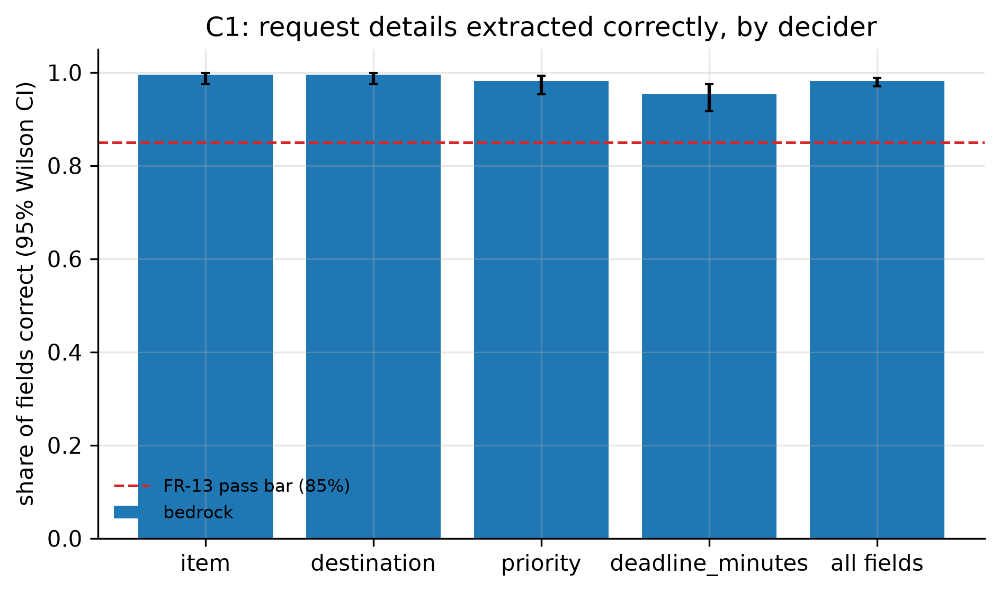
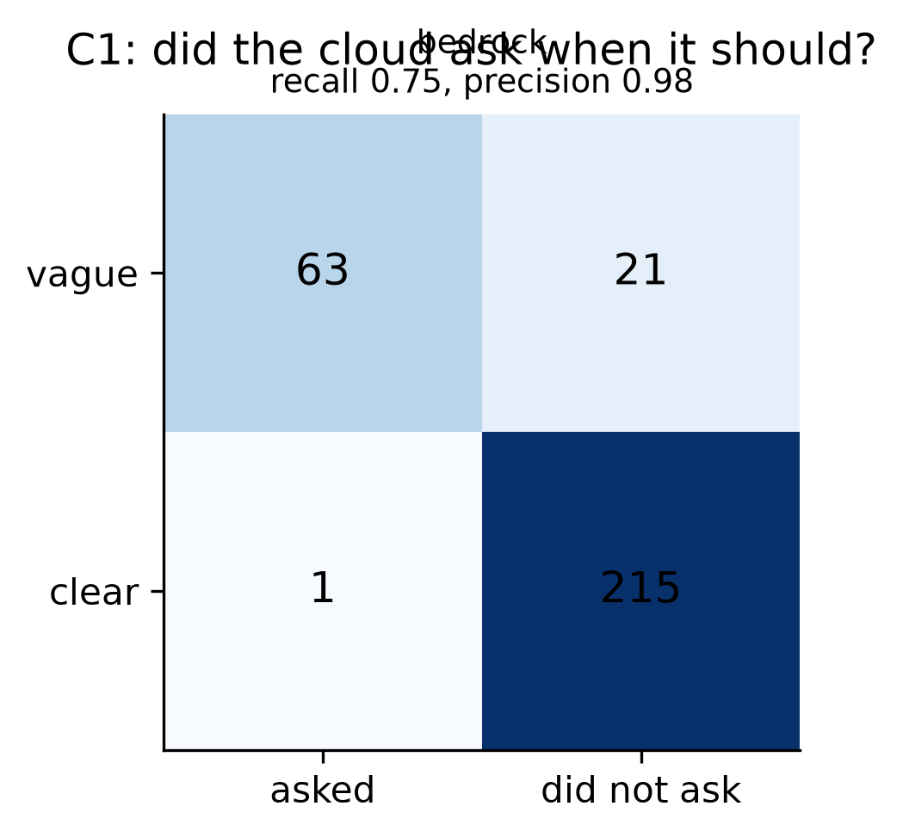
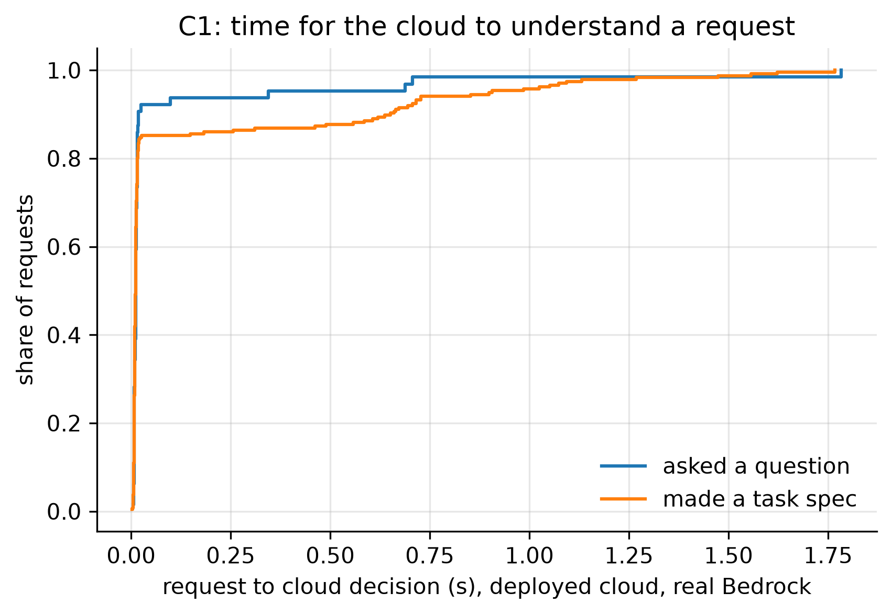

# C1: Request understanding (FR-13, E2 cloud)

- **Claim:** The cloud turns plain-language requests into structured tasks and asks when a request is vague.
- **PRD pass bar:** >= 85% of details right on clear requests; most vague requests get a question (FR-13).
- **Measured:** bedrock: field accuracy 98.1% (95% CI 97.0% to 98.9%), clarification recall 75.0%, precision 98.4%, 300 request decisions
- **Verdict:** PASS
- **Source of numbers:** real_bedrock (local-C1-bedrock, model apac.amazon.nova-lite-v1:0)
- **Command:** `python experiments/cloud/c1_understanding.py --target local-bedrock --decider bedrock`
- **Commit:** 485d898, run 2026-11-06T18:03:16Z to 2026-11-06T18:04:57Z

## Plots

## Notes

- bedrock: field accuracy 98.1%, recall 75.0%, precision 98.4%, 1 questions on clear requests
- Labels in both request sets are drafts written by the team; review them before quoting as gold.
- A deadline that the request does not state is scored against the pack default (urgent 12 min, routine 60 min).
- On the deployed cloud, earlier confirmed habits (FR-19 memory) can legitimately resolve a vague pump request without a question; such cases count as 'should have asked' here. errors.json lists every miss.
- Compared with `C1_deployed` (same model, older cloud code: 94.0% field accuracy, 72.6% clarification recall), the current code gives 98.1% field accuracy and 75.0% recall here, so field accuracy is above the 96.3% the what-if predicted but recall is far below the predicted 92.9%. All 7 missed questions are vague pump requests that were answered without asking (see `errors.json`); the earlier note about confirmed habits resolving pump requests may explain them, but this was not checked. The model itself was called only in 23 of the 300 decisions (50,909 input tokens); the other decisions were settled before or without the model.

Raw per-trial records are in `raw/`; `summary.csv` is computed from them by the same script.
