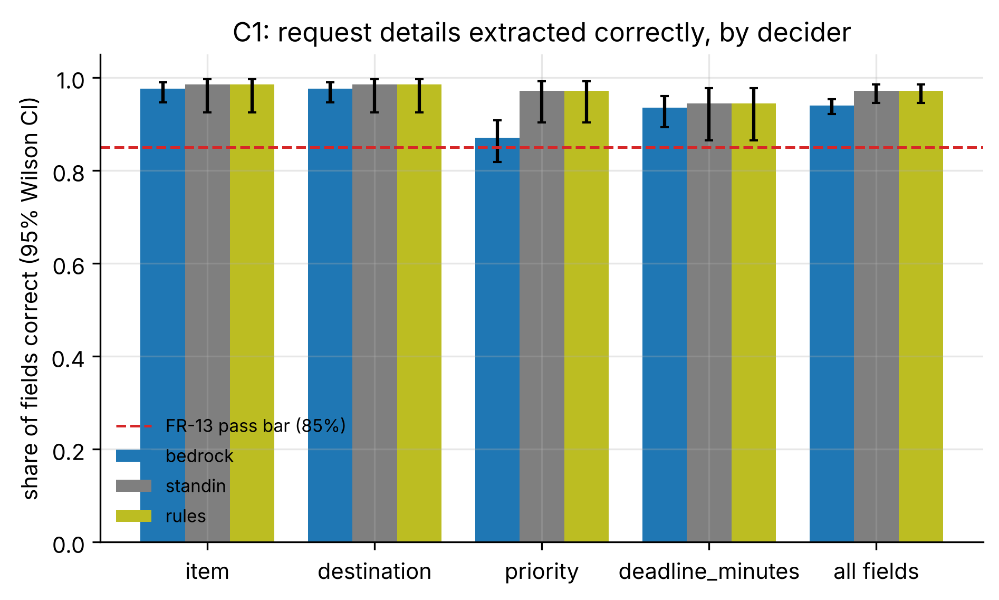
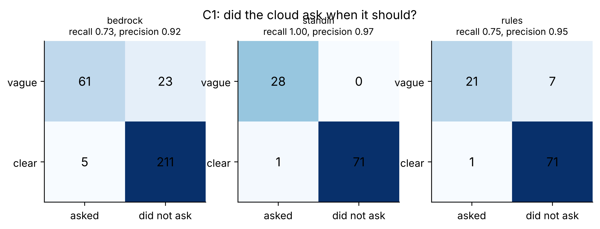
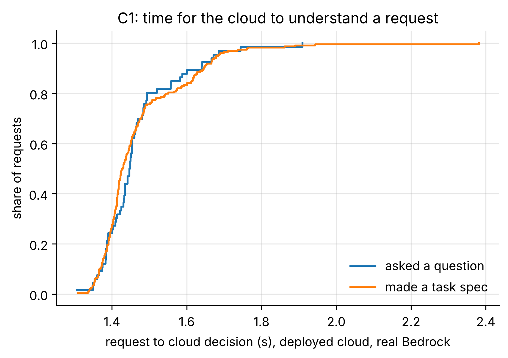

# C1: Request understanding (FR-13, E2 cloud)

- **Claim:** The cloud turns plain-language requests into structured tasks and asks when a request is vague.
- **PRD pass bar:** >= 85% of details right on clear requests; most vague requests get a question (FR-13).
- **Measured:** bedrock: field accuracy 94.0% (95% CI 92.2% to 95.4%), clarification recall 72.6%, precision 92.4%, 300 request decisions
- **Verdict:** PASS
- **Source of numbers:** real_bedrock (deployed, model apac.amazon.nova-lite-v1:0)
- **Command:** `python experiments/cloud/c1_understanding.py`
- **Commit:** 81f0b93-dirty, run 2026-11-06T14:05:10Z to 2026-11-06T14:42:43Z

## Plots

## Notes

- This run is on the DEPLOYED cloud, i.e. the cloud code from before two fixes this experiment led to (commit after this run):
  the cloud now asks when the requester named no destination (the model had filled one in), and priority follows the
  requester's wording rather than a stated deadline. Re-scoring these same 300 recorded Bedrock answers with the two fixes
  (scripts in experiments/cloud/c1_whatif.py) gives field accuracy 96.3% (95% CI 94.8 to 97.4%), clarification recall 92.9%, precision 94.0% (whatif.json).
  The live re-run on the fixed code is `python experiments/cloud/c1_understanding.py --target local-bedrock` (results/final/C1).
- The paediatric-pump misses (req-17, para-43) are a deployment artifact: SOP-PAED-01 asks at allocation time, and with
  both clusters down during this run the requests were queued before reaching that check.

- bedrock: field accuracy 94.0%, recall 72.6%, precision 92.4%, 5 questions on clear requests
- standin: field accuracy 97.2%, recall 100.0%, precision 96.6%, 1 questions on clear requests
- rules: field accuracy 97.2%, recall 75.0%, precision 95.5%, 1 questions on clear requests
- Labels in both request sets are drafts written by the team; review them before quoting as gold.
- A deadline that the request does not state is scored against the pack default (urgent 12 min, routine 60 min).
- On the deployed cloud, earlier confirmed habits (FR-19 memory) can legitimately resolve a vague pump request without a question; such cases count as 'should have asked' here. errors.json lists every miss.

Raw per-trial records are in `raw/`; `summary.csv` is computed from them by the same script.
