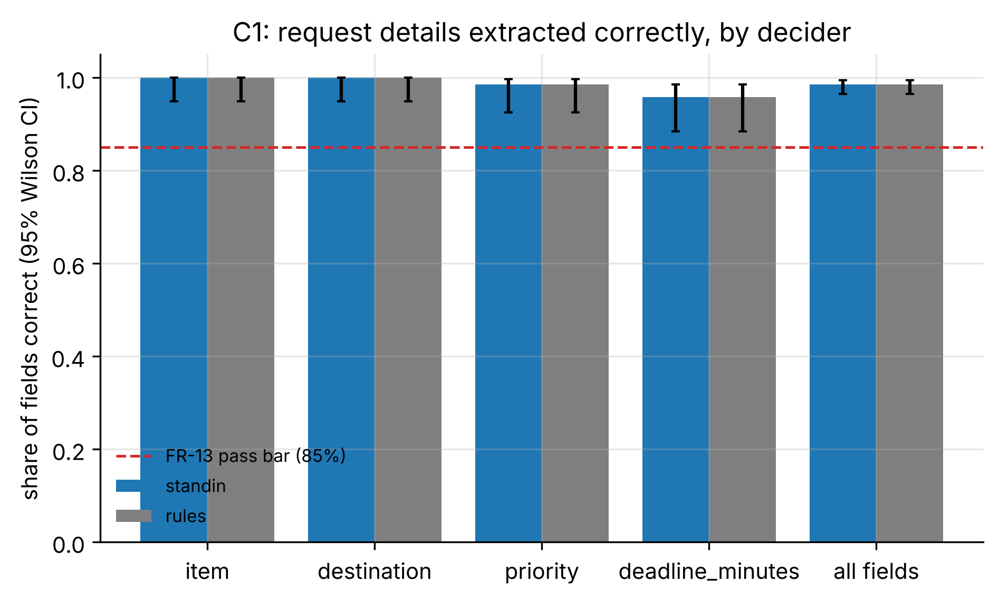
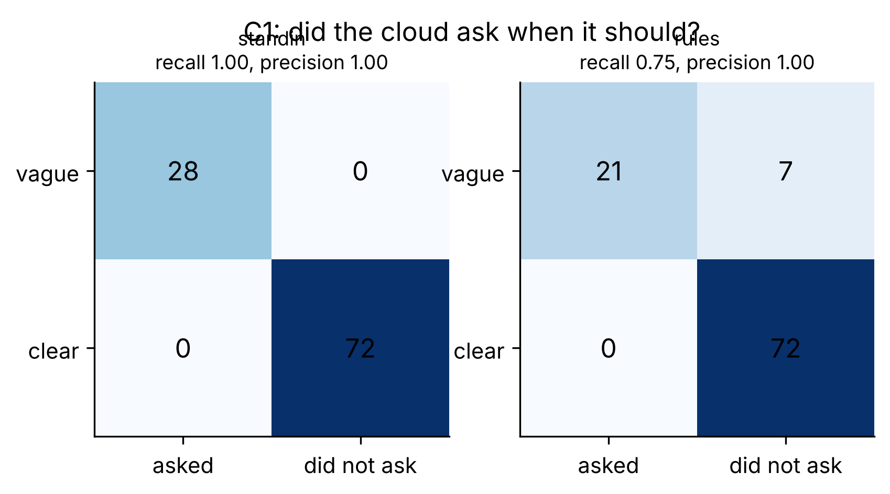

# C1_standin: Request understanding (FR-13, E2 cloud)

- **Claim:** The cloud turns plain-language requests into structured tasks and asks when a request is vague.
- **PRD pass bar:** >= 85% of details right on clear requests; most vague requests get a question (FR-13).
- **Measured:** standin: field accuracy 98.6% (95% CI 96.5% to 99.5%), clarification recall 100.0%, precision 100.0%, 100 request decisions
- **Verdict:** PASS
- **Source of numbers:** mock_llm (standin) / measured (rules) (local, model rule-based-stand-in)
- **Command:** `python experiments/cloud/c1_understanding.py --decider standin --decider rules`
- **Commit:** cee7c04-dirty, run 2026-11-06T15:47:39Z to 2026-11-06T15:47:41Z

## Plots

## Notes

- standin: field accuracy 98.6%, recall 100.0%, precision 100.0%, 0 questions on clear requests
- rules: field accuracy 98.6%, recall 75.0%, precision 100.0%, 0 questions on clear requests
- Labels in both request sets are drafts written by the team; review them before quoting as gold.
- A deadline that the request does not state is scored against the pack default (urgent 12 min, routine 60 min).
- On the deployed cloud, earlier confirmed habits (FR-19 memory) can legitimately resolve a vague pump request without a question; such cases count as 'should have asked' here. errors.json lists every miss.

Raw per-trial records are in `raw/`; `summary.csv` is computed from them by the same script.
