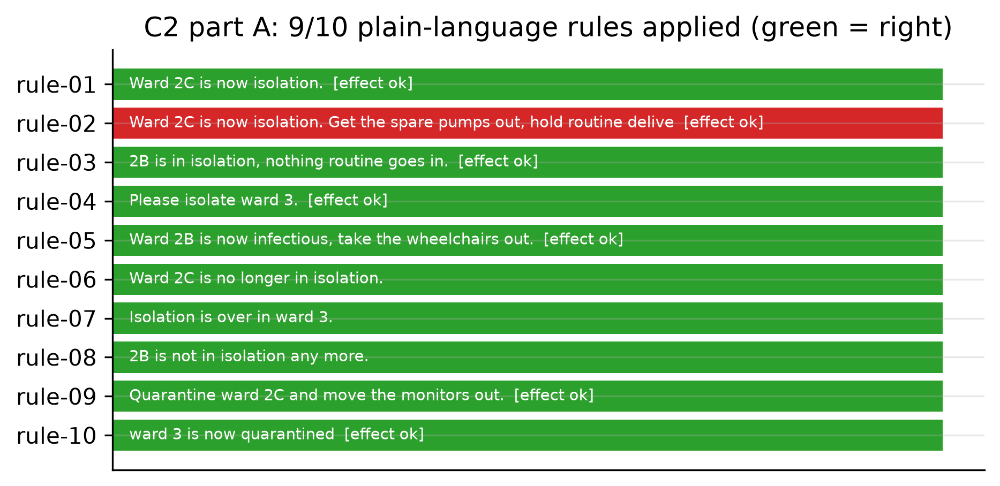
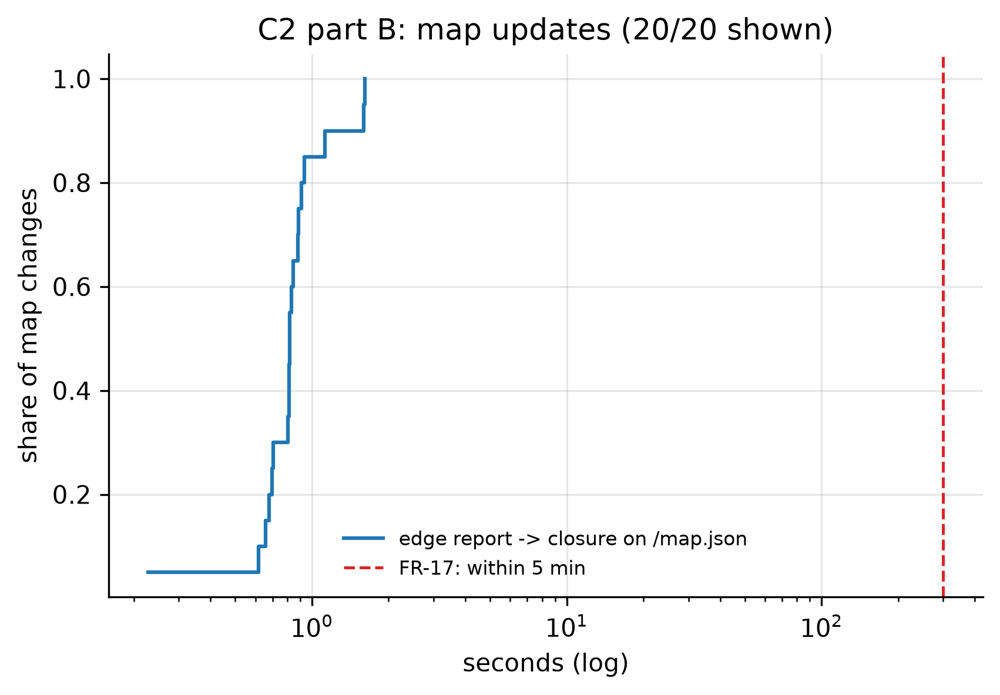

# C2: Plain-language rules and shared map (FR-17)

- **Claim:** Plain-language rules become enforced restrictions, and robot reports update one shared map that later plans respect.
- **PRD pass bar:** Scripted changes reflected in the map within about 5 min in >= 80% of cases; 10 test rules applied correctly (FR-17).
- **Measured:** rules applied correctly 9/10 (apac.amazon.nova-lite-v1:0); effect on deliveries correct 7/7; map changes shown within 5 min 20/20 (p95 1.60 s); next request to the same place avoided the closed zone 20/20
- **Verdict:** FAIL
- **Source of numbers:** real_bedrock (in-process, model n/a)
- **Command:** `python experiments/cloud/c2_rules_map.py --target local-bedrock --llm bedrock`
- **Commit:** 485d898, run 2026-11-06T17:52:13Z to 2026-11-06T17:58:37Z

## Plots

## Notes

- Part A runs in-process so a restriction can be pre-declared for the 'lift' statements; part B goes through the HTTP API.
- Every map change is reopened and its tasks cancelled before the next one.
- Verdict is FAIL because of one rule. In rule-02 ("Ward 2C is now isolation. Get the spare pumps out, hold routine deliveries there, urgent ones can still go in.") the model set the restriction and its effect correctly (routine held, urgent allowed), but no pumps were moved out (`items_moved_out` is empty, gold is `infusion_pump`). Either the model did not return the item to move or no pump was in stock in that ward at that time; the raw record does not say which, so this is kept as a real miss. Map-change times are now about a second (p95 1.60 s) because 18 of the 20 reactions were decided by the model; with the rules only they were 0.06 s.

Raw per-trial records are in `raw/`; `summary.csv` is computed from them by the same script.
