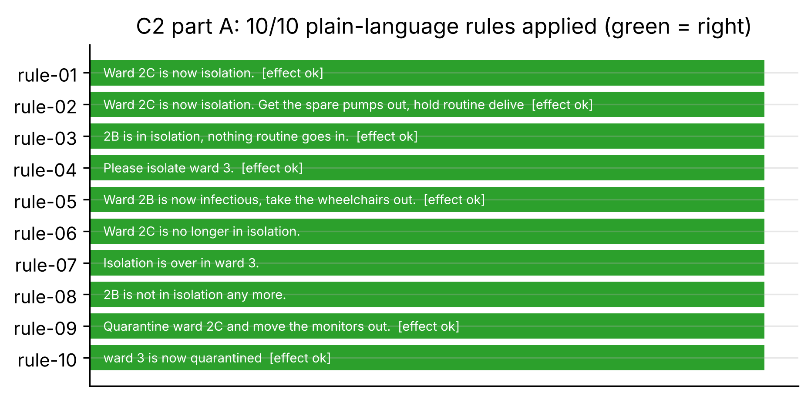
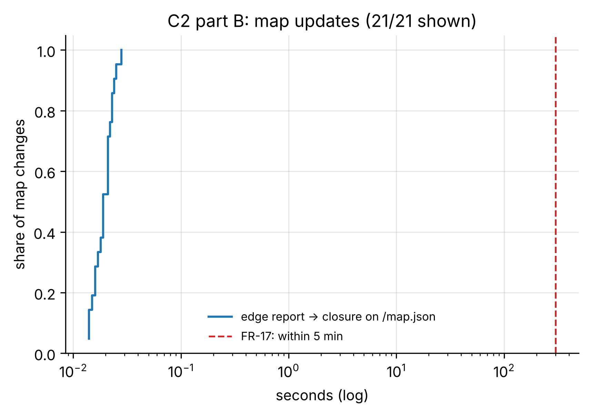

# C2_standin: Plain-language rules and shared map (FR-17)

- **Claim:** Plain-language rules become enforced restrictions, and robot reports update one shared map that later plans respect.
- **PRD pass bar:** Scripted changes reflected in the map within about 5 min in >= 80% of cases; 10 test rules applied correctly (FR-17).
- **Measured:** rules applied correctly 10/10 (rule-based-stand-in); effect on deliveries correct 7/7; map changes shown within 5 min 21/21 (p95 0.03 s); next request to the same place avoided the closed zone 21/21
- **Verdict:** PASS
- **Source of numbers:** mock_llm (in-process, model n/a)
- **Command:** `python experiments/p3/c2_rules_map.py --target local --events 21`
- **Commit:** 81f0b93-dirty, run 2026-11-06T14:50:22Z to 2026-11-06T14:55:49Z

## Plots

## Notes

- Part A runs in-process so a restriction can be pre-declared for the 'lift' statements; part B goes through the HTTP API.
- Every map change is reopened and its tasks cancelled before the next one.

Raw per-trial records are in `raw/`; `summary.csv` is computed from them by the same script.
