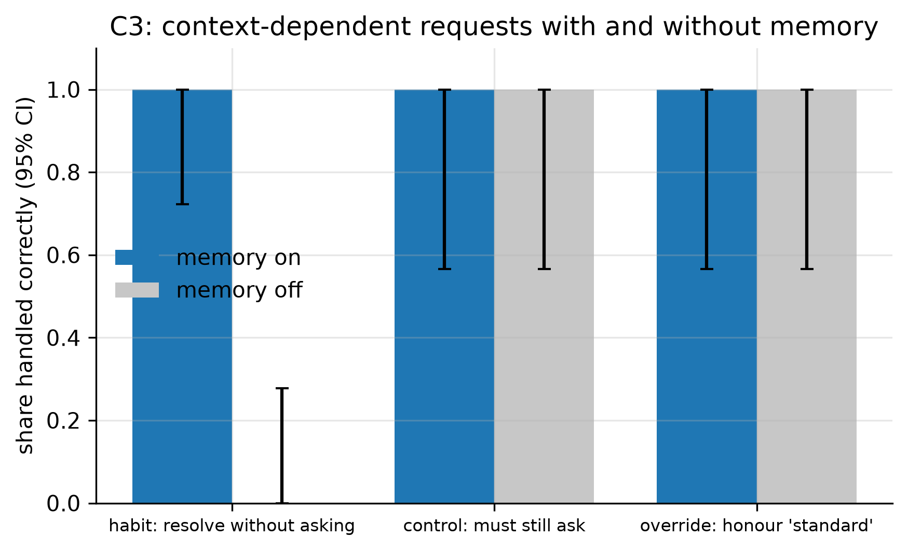

# C3: Memory and habits (FR-19)

- **Claim:** Confirmed habits let the cloud resolve a repeat request without asking again, without overriding an explicit choice.
- **PRD pass bar:** Most of 20 context-dependent requests resolved without asking (FR-19).
- **Measured:** memory on: 20/20 cases right, habit cases resolved without asking 10/10; memory off: the same habit requests asked 10/10 times (questions saved by memory)
- **Verdict:** PASS
- **Source of numbers:** real_bedrock (local-bedrock, model apac.amazon.nova-lite-v1:0)
- **Command:** `python experiments/cloud/c3_memory.py --target local-bedrock`
- **Commit:** 0a86d90, run 2026-11-06T17:19:31Z to 2026-11-06T17:20:40Z

## Plots

## Notes

- The case set repeats three phrasings; labels are drafts until reviewed.
- A habit needs 2 confirmations (cloud/memory.py CONFIRMATIONS); controls with 0 or 1 confirmation must still ask.

Raw per-trial records are in `raw/`; `summary.csv` is computed from them by the same script.
