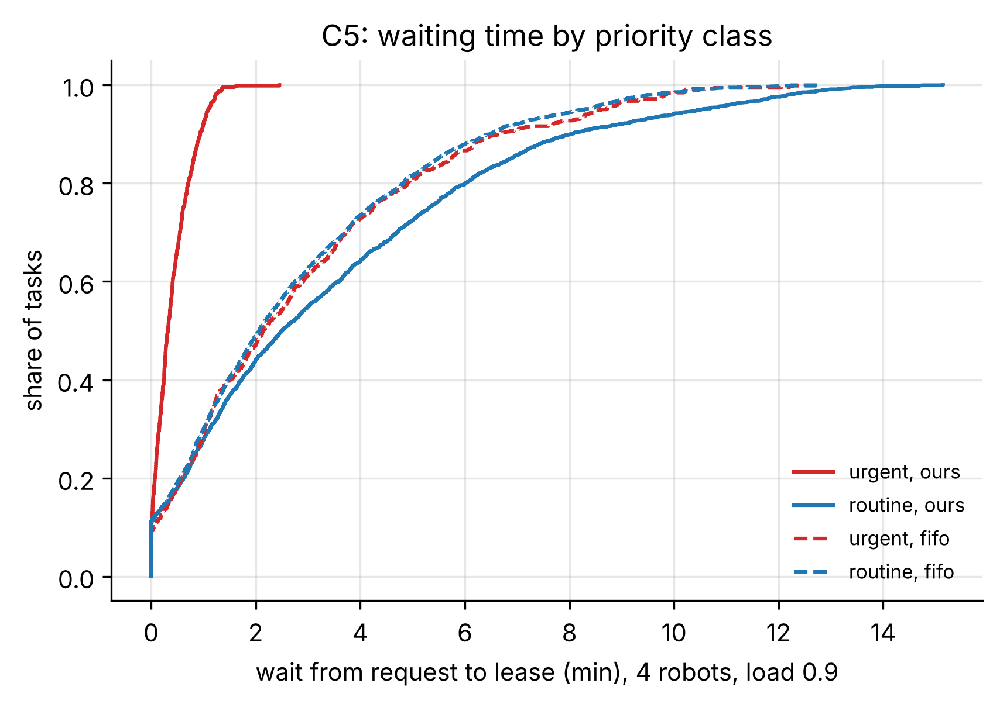
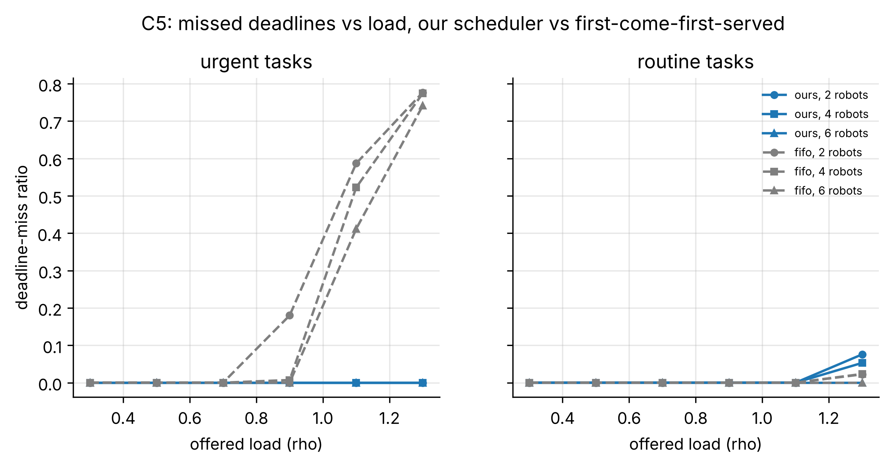
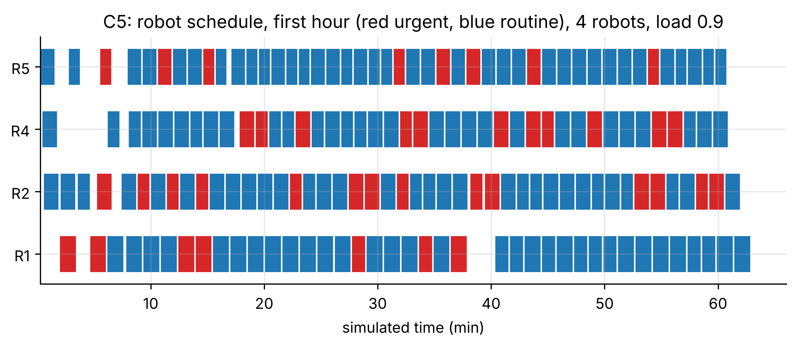

# C5: Priority scheduling (FR-14, T8)

- **Claim:** Urgent work goes first: the queue never gives a robot to a routine task while an urgent one it could serve is waiting.
- **PRD pass bar:** An urgent task never waits behind a routine one in the queue (FR-14); T8 handled.
- **Measured:** queue inversions: ours 0, first-come-first-served 25009 over 113518 tasks (10 seeds x 3 fleet sizes x 6 loads x 2 h); at load 1.3 with 4 robots urgent miss ratio ours 0.0 vs fifo 0.774, routine 0.053 vs 0.023; T8: urgent served next = True
- **Verdict:** PASS
- **Source of numbers:** measured (in-process cloud on a simulated clock (pack hospital_sim6), model rule-based-stand-in (intent only))
- **Command:** `python experiments/cloud/c5_scheduling.py --seeds 10 --loads 0.3 0.5 0.7 0.9 1.1 1.3`
- **Commit:** 81f0b93-dirty, run 2026-11-06T14:18:05Z to 2026-11-06T14:50:54Z

## Plots

## Notes

- Mean service time 73 s per delivery, measured from the cloud's leases (route length / lease speed + waits).
- The cloud does not preempt a robot already on a routine lease; an urgent task arriving when every robot is busy waits for the next robot to free, then goes first. Preemption is not a PRD requirement.
- Robot travel is simulated (no edge, no Gazebo); every allocation, check, lease and queue decision is the real cloud code.

Raw per-trial records are in `raw/`; `summary.csv` is computed from them by the same script.
