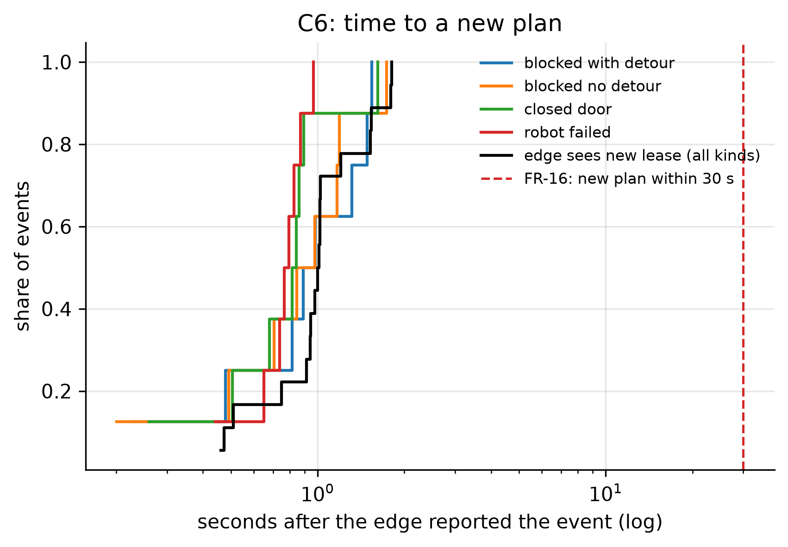
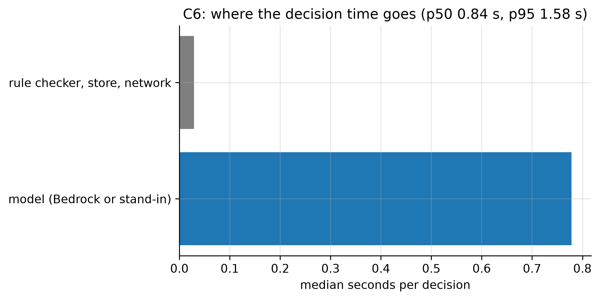
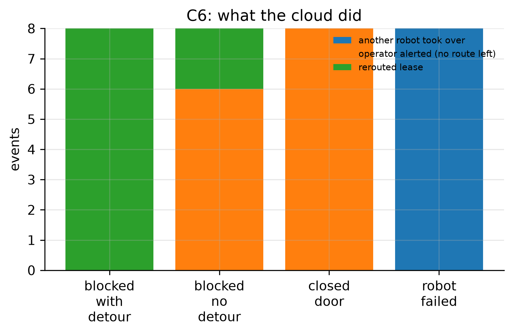

# C6: Re-plan and hand-over latency (FR-16)

- **Claim:** After an unexpected event the cloud issues a new plan (new lease version, hand-over, wait or operator alert) within about 30 s.
- **PRD pass bar:** New plan issued within about 30 s on a good network (FR-16).
- **Measured:** decision p95 1.58 s, p50 0.84 s over 32 events; 18 new lease versions, 18/18 avoid the closed zone or failed robot; outcomes {'rerouted lease': 10, 'operator alerted (no route left)': 14, 'another robot took over': 8}
- **Verdict:** PASS
- **Source of numbers:** real_bedrock (local-C1-bedrock, model apac.amazon.nova-lite-v1:0)
- **Command:** `python experiments/cloud/c6_replan.py --target local-bedrock`
- **Commit:** 9a80a4e, run 2026-11-06T17:50:17Z to 2026-11-06T17:52:03Z

## Plots

## Notes

- Decision time is the POST /escalations round trip from this machine, so it includes the network to the cloud.
- On this map a delivery from the south store to 2B or 2C has only one corridor inside its wing, so blocking it often leaves no route in the cluster: then the cloud waits, hands over, or alerts the operator. Those are plans too; the 'actions' plot shows which.
- Every event's zone is reopened and its task cancelled before the next event.
- The real model decided 21 of the 32 incidents (`decided_by` is `llm`, 20.4 s of model time in total); the rules decided the other 11 without a model call. This is why decision time is about a second instead of the stand-in's 0.02 s.

Raw per-trial records are in `raw/`; `summary.csv` is computed from them by the same script.
