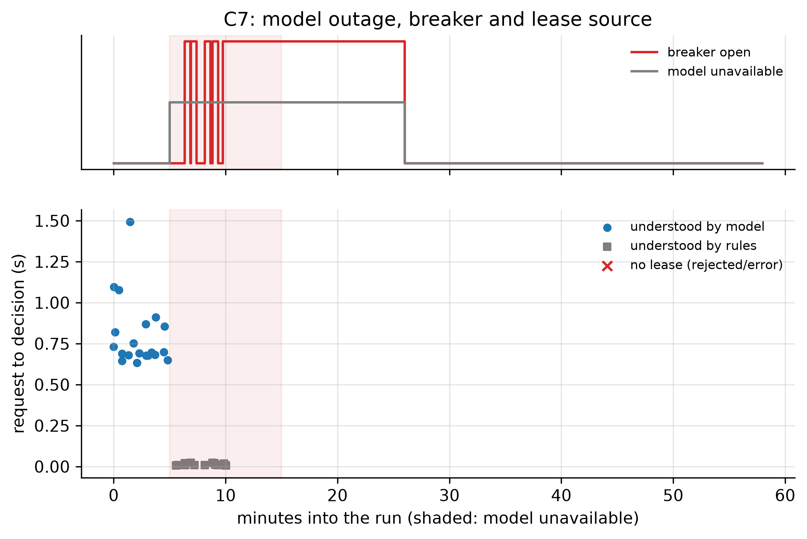

# C7: Cloud model outage and rule fallback (FR-18)

- **Claim:** When the cloud model is unavailable, leased work continues, new requests still get leases from the deterministic rules, and users are told.
- **PRD pass bar:** Model calls forced to fail for 10 min mid-run: leased tasks continue; new requests still leased via the fallback; user told (FR-18).
- **Measured:** 14 requests during the 600 s outage: 5 leased, 9 queued for a robot, 0 answered by the model, 14 carried the reduced-autonomy notice; 14/14 tasks leased before the outage completed; breaker/fault seen at 300.21 s, normal again at 1560.37 s (outage 300 to 900 s)
- **Verdict:** PASS
- **Source of numbers:** real_bedrock (local-C1-bedrock, model apac.amazon.nova-lite-v1:0)
- **Command:** `python experiments/cloud/c7_bedrock_outage.py --target local-bedrock`
- **Commit:** 65892f6, run 2026-11-06T18:50:26Z to 2026-11-06T19:48:25Z

## Plots

## Notes

- Outage started with POST /llm/outage at 300.1492397785187 s, reply {'http': 201, 'model_down': True, 'seconds': 600}.
- Requests the rules cannot understand still get a question; they are not counted as failures.
- Before the outage the real model understood all 20 requests (21 model calls, none failed). During the outage all 14 requests were understood by the rules and carried the reduced-autonomy notice.
- This run sent no requests after the outage, so the return of the real model is shown only by the status poll (`llm_status.jsonl`: the fault is off and the circuit closed at 1560 s), not by answered requests. The status poll has a gap between 585 s and 1560 s, so the exact time the model came back is not measured.

Raw per-trial records are in `raw/`; `summary.csv` is computed from them by the same script.
