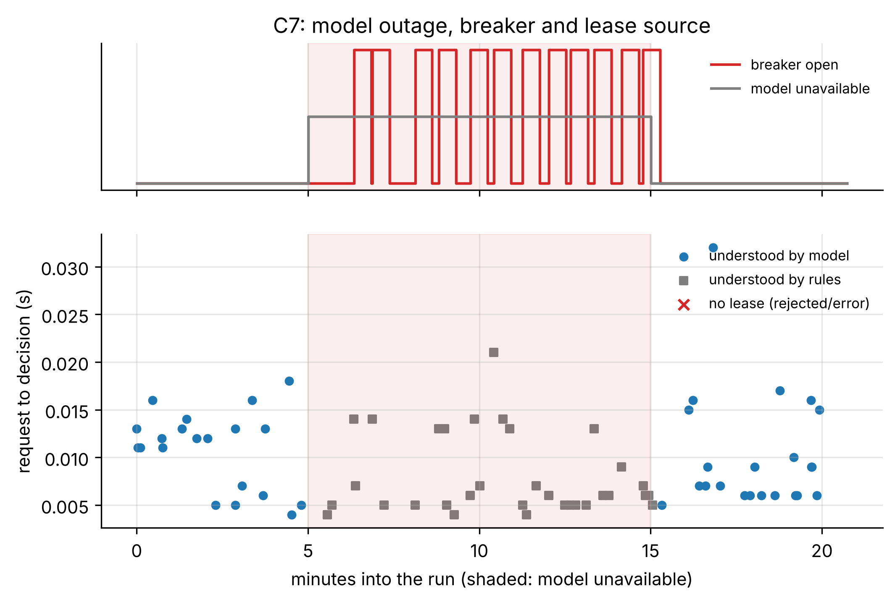

# C7_local: Cloud model outage and rule fallback (FR-18)

- **Claim:** When the cloud model is unavailable, leased work continues, new requests still get leases from the deterministic rules, and users are told.
- **PRD pass bar:** Model calls forced to fail for 10 min mid-run: leased tasks continue; new requests still leased via the fallback; user told (FR-18).
- **Measured:** 32 requests during the 600 s outage: 9 leased, 23 queued for a robot, 0 answered by the model, 32 carried the reduced-autonomy notice; 14/14 tasks leased before the outage completed; breaker/fault seen at 300.86 s, normal again at 916.99 s (outage 300 to 900 s)
- **Verdict:** PASS
- **Source of numbers:** mock_llm (local-C1, model rule-based-stand-in)
- **Command:** `python experiments/cloud/c7_bedrock_outage.py --target local`
- **Commit:** 81f0b93-dirty, run 2026-11-06T14:48:37Z to 2026-11-06T15:09:23Z

## Plots

## Notes

- Outage started with POST /llm/outage at 300.19439673423767 s, reply {'http': 201, 'model_down': True, 'seconds': 600}.
- Requests the rules cannot understand still get a question; they are not counted as failures.

Raw per-trial records are in `raw/`; `summary.csv` is computed from them by the same script.
