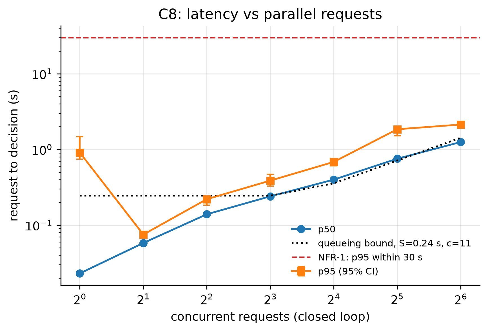
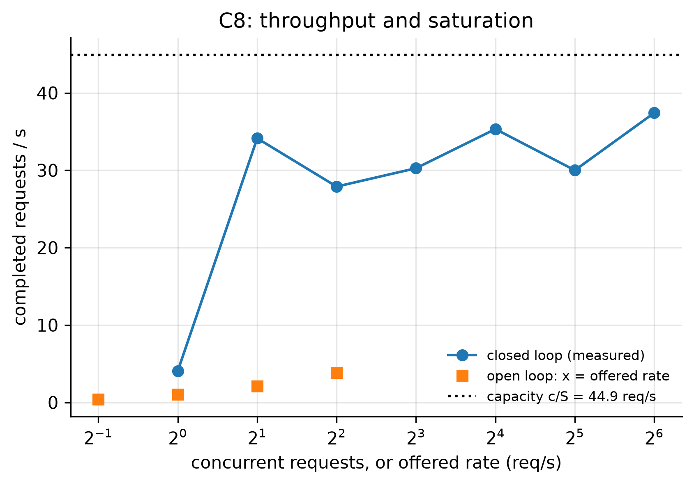
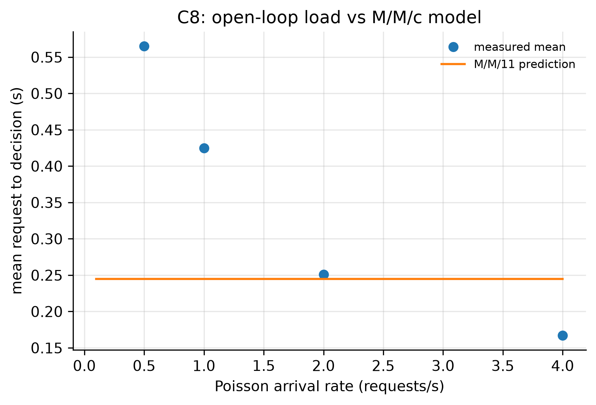

# C8: Request-to-lease latency under parallel load (NFR-1)

- **Claim:** A request becomes a lease (or a clear queue/question decision) within 30 s at the expected load, and the curve shows where the cloud saturates.
- **PRD pass bar:** Request to lease p95 <= 30 s on a good network (NFR-1).
- **Measured:** at 0.5 req/s: p95 0.932 s, errors 0.0; worst p95 over all levels 2.13 s; p95 first above 30 s at N=None; fitted S=0.24 s, c=11 -> capacity about 44.9 req/s
- **Verdict:** PASS
- **Source of numbers:** real_bedrock (local-C1-bedrock, model apac.amazon.nova-lite-v1:0)
- **Command:** `python experiments/cloud/c8_load.py --target local-bedrock`
- **Commit:** 0489b22, run 2026-11-06T18:44:31Z to 2026-11-06T18:49:52Z

## Plots

## Notes

- Decision time is measured at the client, so it includes the internet path to API Gateway.
- 'Leased at once' needs a free robot; under parallel load several requests compete for the same robot, so some are queued for a moment: that is correct behaviour and not cloud latency.
- Every task is cancelled right after its decision (robot freed, item returned), so the run leaves no work and uses no stock.
- This ran on a local cloud with the real Bedrock model, from the same machine, so there is no internet or API Gateway path in the times (the first note above applies to the deployed cloud only). No request failed and Bedrock throttling did not show up (0 errors at every level).
- The median decision is 23 ms at one client, far too fast for a model call, and the spread (p95 0.9 s) suggests only some requests reach the model. In C1 the cloud also called the model for only 23 of 300 requests, so most of C8's fixed, clear request texts are probably settled without it. This was not confirmed from the cloud's counters, so read the numbers as the cloud's overall request path and not as the cost of a model call for every request.

Raw per-trial records are in `raw/`; `summary.csv` is computed from them by the same script.
