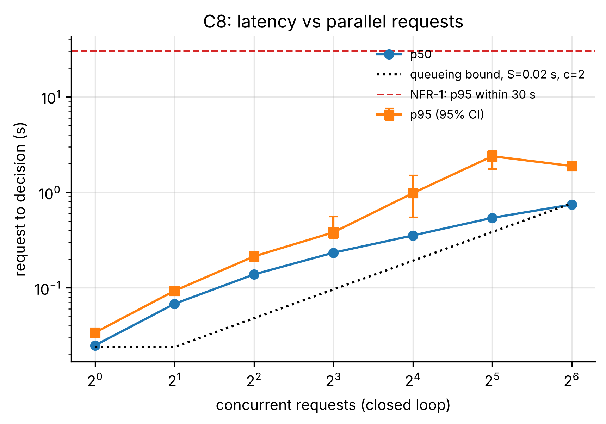
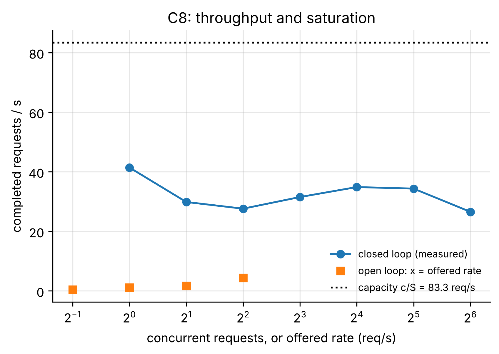
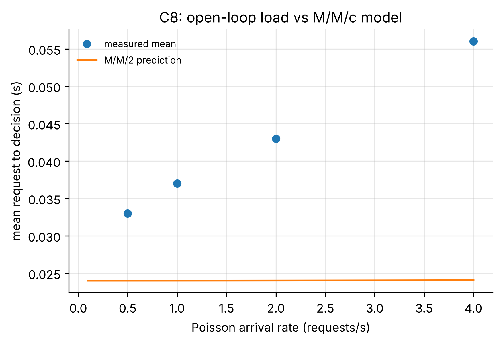

# C8_local: Request-to-lease latency under parallel load (NFR-1)

- **Claim:** A request becomes a lease (or a clear queue/question decision) within 30 s at the expected load, and the curve shows where the cloud saturates.
- **PRD pass bar:** Request to lease p95 <= 30 s on a good network (NFR-1).
- **Measured:** at 0.5 req/s: p95 0.042 s, errors 0.0; worst p95 over all levels 2.38 s; p95 first above 30 s at N=None; fitted S=0.02 s, c=2 -> capacity about 83.3 req/s
- **Verdict:** PASS
- **Source of numbers:** mock_llm (local-C1, model rule-based-stand-in)
- **Command:** `python experiments/cloud/c8_load.py --target local --window 30`
- **Commit:** 81f0b93-dirty, run 2026-11-06T14:59:33Z to 2026-11-06T15:02:29Z

## Plots

## Notes

- Decision time is measured at the client, so it includes the internet path to API Gateway.
- 'Leased at once' needs a free robot; under parallel load several requests compete for the same robot, so some are queued for a moment: that is correct behaviour and not cloud latency.
- Every task is cancelled right after its decision (robot freed, item returned), so the run leaves no work and uses no stock.

Raw per-trial records are in `raw/`; `summary.csv` is computed from them by the same script.
