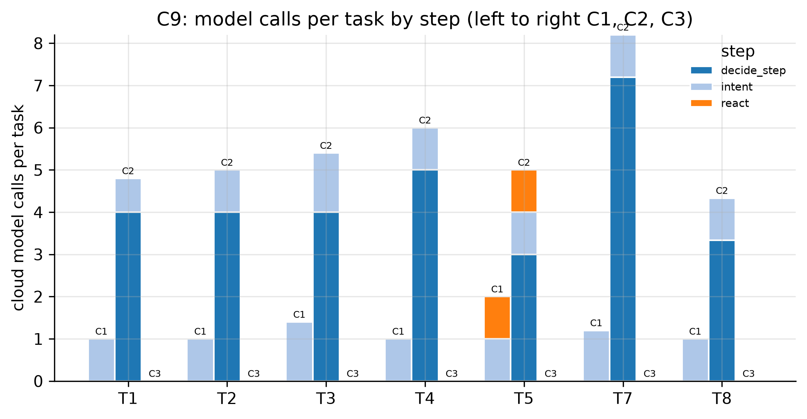

# C9: Cloud model calls per task, C1 vs C2 vs C3 (NFR-4 input)

- **Claim:** Leased edge autonomy (C1) needs at most half the cloud model calls of the cloud-only relay (C2).
- **PRD pass bar:** C1 cloud LLM calls per task <= 50% of C2 (NFR-4).
- **Measured:** calls per task C1 1.18, C2 5.27, C3 0.00; C1/C2 = 22.4%
- **Verdict:** PASS
- **Source of numbers:** real_bedrock (local-bedrock, model apac.amazon.nova-lite-v1:0)
- **Command:** `python experiments/cloud/c9_llm_calls.py --target local-bedrock --repeats 5`
- **Commit:** 4c97ce3-dirty, run 2026-11-06T18:26:51Z to 2026-11-06T18:43:46Z

## Plots

## Notes

- Call counts come from the cloud's trace of each task; the simulated edge only decides WHEN to call (per protocol), never what the model answers.
- C2's relay here is the cloud's real POST /relay/decide; the edge supervisor does not call it yet, so this is the C2 protocol as specified, driven by the harness.
- With a real model, the C2 relay calls are paced 3 s apart (a robot takes seconds per step). Fired as a burst, Bedrock answered ThrottlingException, the cloud's circuit breaker opened and the rest of the C2 run was decided by rules: that measured 1.89 calls per task and C1/C2 = 61.2%, which was throttling, not the protocol. raw/tasks.jsonl records relay_http and llm_errors per task so this is visible.
- Token counts are estimates unless the run used a real model (see tokens_estimated).
- 8 of 135 tasks (7 of them the three parallel T8 tasks, in C2) had one or two relay calls throttled by Bedrock and answered by the rules; those calls are not counted as model calls. This lowers C2's count a little, so C1/C2 = 22.4% is, if anything, slightly high. All 135 tasks were leased.

Raw per-trial records are in `raw/`; `summary.csv` is computed from them by the same script.
