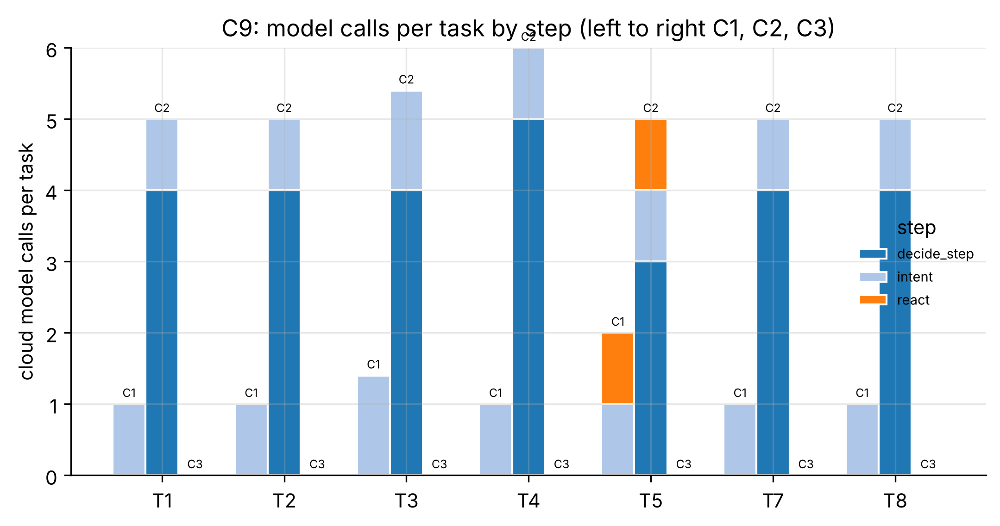

# C9_standin: Cloud model calls per task, C1 vs C2 vs C3 (NFR-4 input)

- **Claim:** Leased edge autonomy (C1) needs at most half the cloud model calls of the cloud-only relay (C2).
- **PRD pass bar:** C1 cloud LLM calls per task <= 50% of C2 (NFR-4).
- **Measured:** calls per task C1 1.16, C2 5.16, C3 0.00; C1/C2 = 22.4%
- **Verdict:** PASS
- **Source of numbers:** mock_llm (local, model rule-based-stand-in)
- **Command:** `python experiments/cloud/c9_llm_calls.py --target local --repeats 5`
- **Commit:** cee7c04-dirty, run 2026-11-06T15:53:20Z to 2026-11-06T16:01:04Z

## Plots

## Notes

- Call counts come from the cloud's trace of each task; the simulated edge only decides WHEN to call (per protocol), never what the model answers.
- C2's relay here is the cloud's real POST /relay/decide; the edge supervisor does not call it yet, so this is the C2 protocol as specified, driven by the harness.
- Token counts are estimates unless the run used a real model (see tokens_estimated).

Raw per-trial records are in `raw/`; `summary.csv` is computed from them by the same script.
