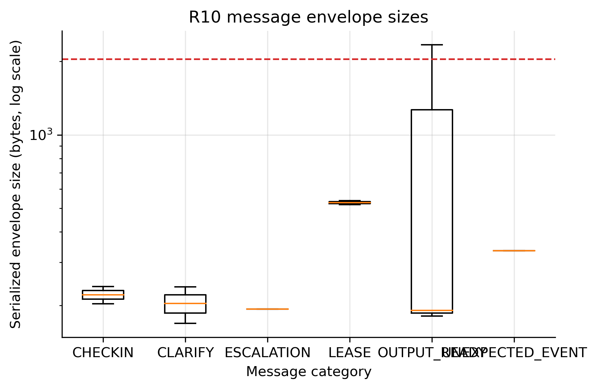
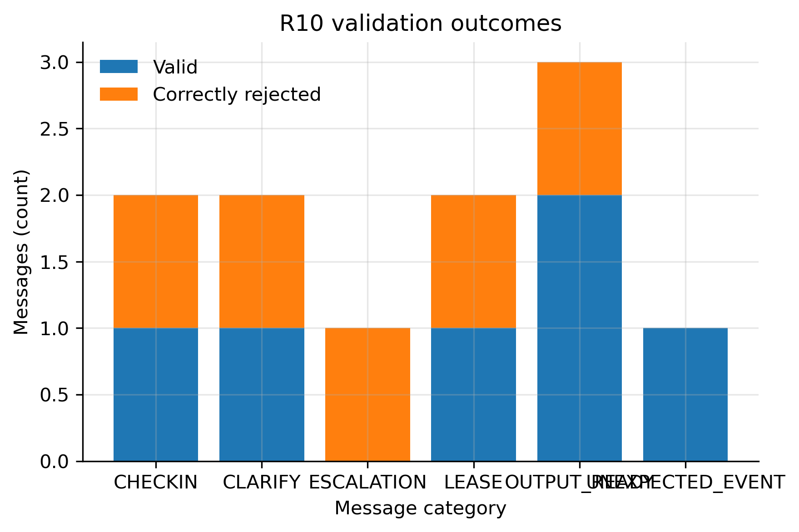

# R10: Escalation format and message sizes

- **Claim:** Fixture-level Nimbus escalation, lease, and check-in envelopes serialize within the 2 KB FR-9 limit and the three escalation schemas accept only valid forms.
- **PRD pass bar:** 100% valid tested escalations; lease, check-in and escalation envelopes <= 2 KB; OUTPUT_READY artifacts 200 KB to 2 MB.
- **Measured:** 11 envelopes: 5/5 expected-valid in-limit envelopes passed; 5/5 malformed envelopes rejected; OUTPUT_READY uses a result_ref, so artifact bytes are not part of this envelope test.
- **Verdict:** PASS
- **Source of numbers:** measured (in-process published contracts and production serialization, model n/a)
- **Command:** `python experiments/robot_edge/r10_escalation_contracts.py --seed 1 --out results/final/R10`
- **Commit:** 77adaa6-dirty, run 2026-11-07T12:44:30Z to 2026-11-07T12:44:31Z

## Plots

## Notes

- Default corpus is generated fixtures based on production message shapes; it is not end-to-end traffic.
- The published OUTPUT_READY schema carries a result_ref URI, not embedded artifact bytes; its envelope is measured separately from artifacts.
- The 200 KB to 2 MB range concerns result artifacts, not the OUTPUT_READY envelope: this protocol deliberately sends a result_ref instead of embedded artifact bytes. It is therefore N/A to this wire-contract verdict.
- Use --input-dir <directory> to include future R1--R9 JSON/JSONL captured envelopes; unsupported/non-envelope records are ignored.
- Pass one or more captured files with --artifact to measure their actual bytes against the 200 KB to 2 MB requirement.

Raw per-trial records are in `raw/`; `summary.csv` is computed from them by the same script.
