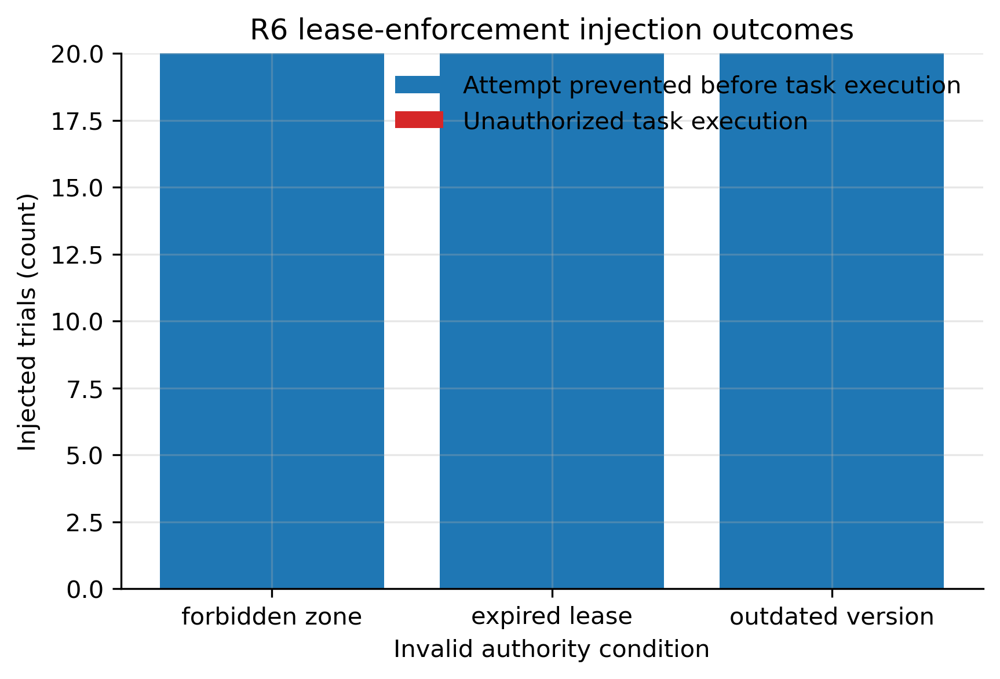
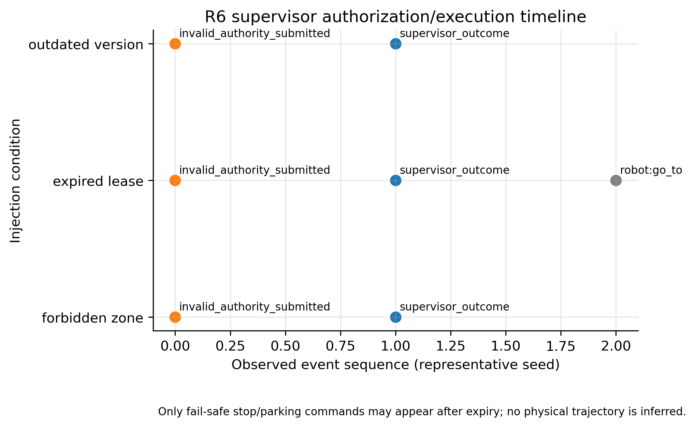

# R6: Lease enforcement

- **Claim:** The headless edge supervisor prevents forbidden, expired, and stale-lease task commands from reaching MockRobot execution.
- **PRD pass bar:** Zero lease violations across 20 forbidden-zone, 20 expired-lease, and 20 outdated-version injections (FR-5).
- **Measured:** 60 injections: 0 unauthorized task executions; 60/60 attempted invalid task commands prevented before MockRobot execution. Expiry produced 20 authorised safe-parking commands.
- **Verdict:** PASS
- **Source of numbers:** measured (in-process EdgeSupervisor with MockRobot (headless), model mock rules only)
- **Command:** `python experiments/robot_edge/r6_lease_enforcement.py --seed 1 --out results/final/R6`
- **Commit:** 20d9655, run 2026-11-07T12:51:23Z to 2026-11-07T12:52:39Z

## Plots

## Notes

- Evidence is supervisor-level enforcement against the production MockRobot dispatch path; it is not physical Gazebo validation.
- For expired leases, the attempted task command is prevented, while an authorised safe-parking command may execute as a fail-safe action.
- Every trial used an isolated SQLite store; all rejection reasons, command-store records, and MockRobot outcomes are retained in raw JSONL.

Raw per-trial records are in `raw/`; `summary.csv` is computed from them by the same script.
