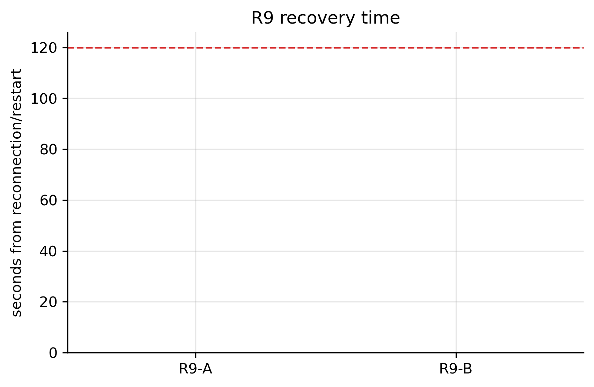
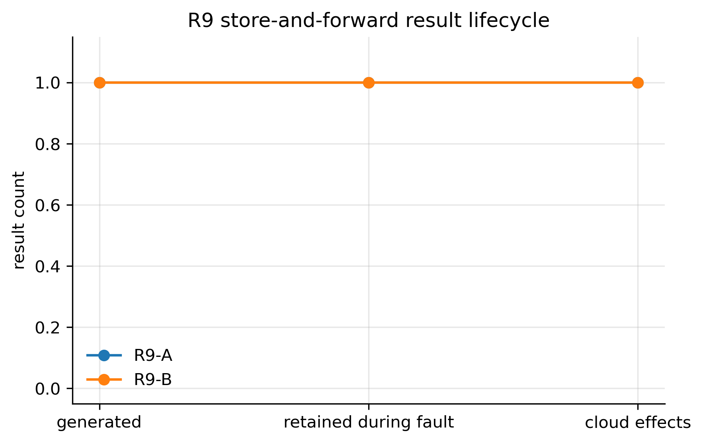

# R9: Store-and-Forward and Reconnection

- **Claim:** Results persist in SQLite over cloud and edge outages and reconcile exactly once.
- **PRD pass bar:** For each 600 s fault: one generated result retained/uploaded once; reconciliation <60 s; normal lease operation <120 s; no conflict.
- **Measured:** R9-A: 600.375 s outage, 0.135 s reconciliation, 0.138 s lease-operation recovery, and 1 exactly-once processing effect. R9-B: 600.008 s outage, 0.120 s reconciliation, 0.122 s lease-operation recovery, and 1 exactly-once processing effect. Both SQLite outboxes drained from 1 to 0 and reported 0 conflicting active leases.
- **Verdict:** PASS
- **Source of numbers:** measured (in-process, model n/a)
- **Command:** `python experiments/robot_edge/r9_store_forward_reconnection.py --mode full`
- **Commit:** 52730e6-dirty, run 2026-11-07T14:17:36Z to 2026-11-07T14:37:41Z

## Plots

## Notes

- Full mode uses wall-clock 600-second outages for R9-A and R9-B; smoke mode is harness validation only.
- R9-A isolates cloud-edge connectivity via the production OutboxUploadWorker network gate.
- R9-B terminates and restarts a separate EdgeSupervisor process against the same SQLite database.
- The local receiver records cloud processing effects and returns duplicate acknowledgement without a second effect.

Raw per-trial records are in `raw/`; `summary.csv` is computed from them by the same script.
