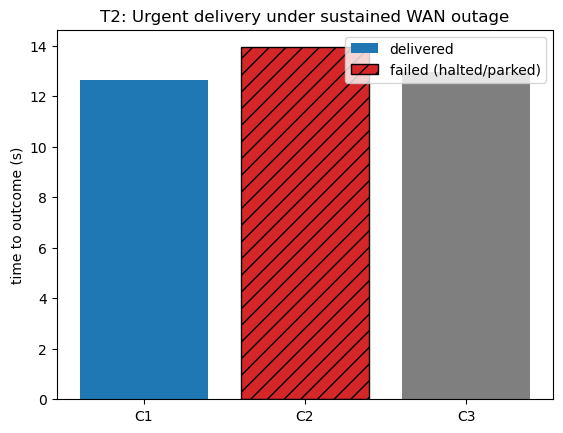
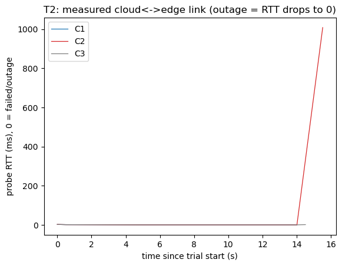

# T2: Urgent delivery under a sustained WAN outage

- Trials: 3  |  generated 2026-11-07T14:03:42Z  |  commit c607884
- Pack: `packs/hospital_sim6_t2` (compressed timing)  |  obstacle: `east_mid_hall`
- tc available: False  |  ping available: False

## Scenario

- Mission: `Need a pediatric infusion pump at 2B-12, urgent.` through the real request -> allocation -> checker -> lease -> edge path.
- Cloud: local, launched per `NIMBUS_MODE` (C2 is a real C2 cloud; relay never hits a C1 endpoint).
- Edge: the real `edge/supervisor/supervisor.py` driven in-process (C1 edge SLM / C2 cloud relay / C3 local rules).
- Outage: cloud<->edge link cut (local cloud paused) the instant the lease is ingested, held to end of mission.
- A persistent corridor obstacle forces a tactical decision mid-route while the WAN is down.

## Expected contrast

- **C1**: edge SLM detours locally, no cloud needed -> **delivered**.
- **C2**: cloud-only relay can't reach the cloud to decide -> a thin relay has no local brain, so it **halts and escalates to an operator**; with the WAN down the escalation is stuck in the offline outbox (and the lease is never renewed) -> urgent delivery **fails**.
- **C3**: local finite-state rules take a map-valid detour -> **delivered** (classical baseline copes with this particular event).

Edge = the real supervisor (C1 SLM / C2 relay / C3 rules) driven in-process. Outage = the cloud<->edge link cut by pausing the local cloud right after the lease is granted, held to end of mission. A persistent corridor obstacle forces a tactical decision. Compressed-timing pack (1 min urgent deadline + 8 s grace) so C2's lease expires within a short demo window; the mechanism is identical at production scale. RTT/loss/throughput/recovery are measured from HTTP probes and the traffic generator, never inferred from requested settings. Real tc/netem is applied only where tc exists.

## Plots

## Results (per trial)

| mode | outcome | completion (s) | time-to-fail (s) | deadline | rtt (ms) | loss% | recovery (s) | llm |
|---|---|---|---|---|---|---|---|---|
| C1 | delivered | 12.648 | None | met | 1.53 | 60.0 | None | 1 |
| C2 | HALTED (no local brain; escalated to operator, but WAN down -> escalation stuck in offline outbox) - delivery FAILED | None | 13.937 | FAIL | 1.62 | 50.0 | 0.95 | 1 |
| C3 | delivered | 12.967 | None | met | 1.52 | 50.0 | 0.94 | 0 |

Raw per-trial records are in `raw/trials.jsonl`; `summary.csv` is computed from them.
