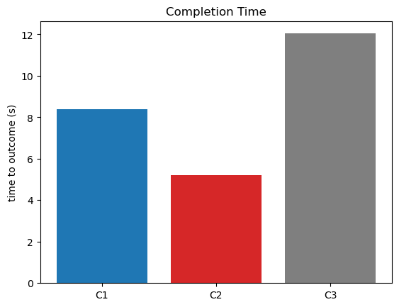
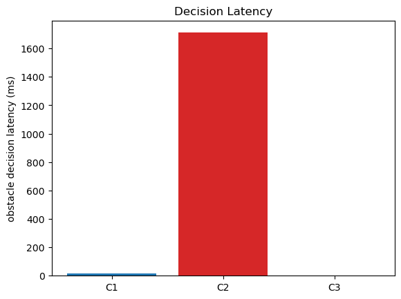

# T4: Blocked corridor; detour inside the lease zone

- Trials: 3  |  generated 2026-11-07T14:37:11Z  |  commit 3b4d96f
- Pack: `packs/hospital_sim6_t2`  |  obstacle: `east_mid_hall`

## Scenario

- Mission: `Need a pediatric infusion pump at 2B-12, urgent.` through the real request -> allocation -> checker -> lease -> edge path.
- A persistent corridor obstacle blocks the route; a valid detour exists INSIDE the lease's zones.
- The edge<->cloud link is a BAD link (degraded latency/jitter/loss) for the whole mission.

## Expected contrast

- **C1**: edge SLM decides the detour locally -> the bad link is not on the decision path -> **fastest**.
- **C2**: cloud-only relay pays one cloud round trip per blocked step over the bad link -> **stalls on the link** (slowest; escalates if the round trip can't resolve).
- **C3**: local finite-state rules detour -> also fast (another classical-baseline point).

Edge = the real supervisor (C1 SLM / C2 relay / C3 rules), kinematic mock robot, driven in-process. A persistent corridor obstacle forces a tactical decision; a detour exists inside the lease. The edge<->cloud link is degraded for the whole mission by an in-process FaultProxy (latency+jitter+loss), not tc. C1 and C3 decide the detour LOCALLY (link not on the decision path) and are fast; C2 must round-trip to the cloud per decision and stalls on the bad link. Completion time and decision latency are measured, not inferred. T4 owns a local cloud for the same reason as T2 (a managed AWS endpoint cannot be degraded like this); T1/T8 use the deployed C1/C2 endpoints.

## Plots

## Results (per trial)

| mode | profile | outcome | time-to-outcome (s) | obstacle decision latency (ms) | decided by | deadline |
|---|---|---|---|---|---|---|
| C1 | severe | delivered | 8.398 | 15.1 | SLM | met |
| C2 | severe | STALLED -> escalated (relay could not resolve over the bad link) | 5.22 | 1711.1 | C2_RELAY | FAIL |
| C3 | severe | delivered | 12.039 | 1.5 | C3_FSM | met |

Raw per-trial records are in `raw/trials.jsonl`; `summary.csv` is computed from them.
Per-decision edge telemetry (with latency) is in `raw/decision_log.jsonl`.
