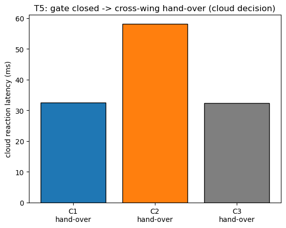

# T5: Gate closed -- cross-wing hand-over (cloud decision)

- Trials: 3  |  generated 2026-11-07T15:05:30Z  |  commit 81d3b18
- Pack: `packs/hospital_sim6_t5`  |  closed gate: `east_south_hall_corner`  |  parked at: `south_equipment_approach`

## Scenario

- Mission: `Deliver a blanket to ward 3, urgent.` to the SHARED ward 3 (wired to both wings in this pack).
- The holder is forced to the east wing; the robot parks at the shared store and the gate on its only in-cluster approach to ward 3 is reported CLOSED, so finishing needs a cross-wing hand-over.

## Expected contrast (ideal: C1 > C2 >> C3)

- **C1 / C2**: cloud LLM agent chooses `hand_over` -> reassign to the west wing in one step.
- **C3**: rules fallback has no `hand_over` verb -> tries `replan` (same wing, fails) -> reaches the hand-over only as a `replan_failed -> reassign` fallback, or alerts an operator.
- (C1 vs C2 are close at this one-shot decision -- same cloud agent; C2's extra cost is per-step relay round trips during execution, not exercised here.)

Cloud-level decision test. A ward-3 (shared) delivery is leased to the EAST wing, then a CLOSED-GATE UNEXPECTED_EVENT is reported over the edge escalation HTTP contract; we read how each config's cloud reaction (react.py) resolves it. C1/C2 run the cloud LLM agent, which can choose `hand_over` -> reassign to the west wing in one step. C3 runs the RULES fallback, which has no hand_over verb: it tries `replan` (same wing, which fails here) and only reaches the hand-over as a replan_failed -> reassign fallback, or alerts an operator. At this one-shot decision C1 and C2 use the same agent and are close; C2's extra cost is the per-step relay round trips during execution, which this test does not exercise. The hand-over is reported to the cloud over HTTP rather than by a kinematic robot, because the kinematic mock robot does not block arbitrary corridors; this isolates the cloud DECISION. Local cloud, as T2/T4 (a managed endpoint can't host the forced closure + fleet control); T1/T8 use the deployed endpoints.

## Plots

## Results (per trial)

| mode | outcome | hand-over | action | decided by | replan-failed first | operator | llm calls | reaction (ms) |
|---|---|---|---|---|---|---|---|---|
| C1 | HAND-OVER east-wing -> west-wing | yes | replan | llm | yes | 1 | 2 | 32.6 |
| C2 | HAND-OVER east-wing -> west-wing | yes | replan | llm | yes | 1 | 2 | 58.1 |
| C3 | HAND-OVER east-wing -> west-wing | yes | replan | rules | yes | 1 | 0 | 32.4 |

Raw per-trial records are in `raw/trials.jsonl`; `summary.csv` is computed from them.
