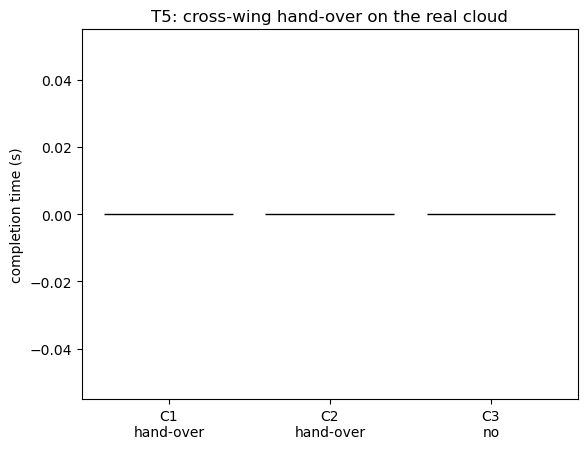

# T5: Gate closed -- cross-wing hand-over (real cloud)

- Trials: 3  |  generated 2026-11-07T16:08:25Z  |  commit a32c832
- Closed corner: `east_south_hall_corner`

## Scenario

- Mission: `Need a pediatric infusion pump at 2B-12, urgent.`. Pickup is the shared store, reachable only via the two south corners.
- The east wing's corner (`east_south_hall_corner`) is reported CLOSED by the edge, so the east wing cannot reach the pickup; the job must cross wings (the west wing collects, the pump reaches 2B via a hand-off between the wings).

## Cloud (per project rule: C1/C2 always use the deployed endpoints)

- **C1** -> deployed `qrgdidp9te` (real Bedrock).  **C2** -> deployed `xkczmnuqla`.  **C3** -> local classical cloud on the real `hospital_sim6` pack.
- Edge: `scripts/edge_sim.py`, one per wing, kinematic; east reports the closed corner.

## Expected contrast (ideal: C1 > C2 >> C3)

- **C1 / C2**: the cloud (real Bedrock) arranges the cross-wing hand-over cleanly.
- **C3**: the classical cloud reaches the hand-over only through its rules fallback.

REAL run: C1/C2 use the deployed AWS endpoints (real Bedrock); C3 uses a local classical cloud on the real hospital_sim6 pack. Edge = scripts/edge_sim.py (one per wing, kinematic); the east client reports the closed store corner (east_south_hall_corner) via the real edge closure contract, so the east wing can't reach the pickup and the job crosses wings. We measure whether a cross-wing hand-over happened, the wing/leg sequence, who decided it (LLM vs rules), and completion. No map/pack changes to the cloud -- the scenario uses the real map.

## Plots

## Results (per trial)

| mode | cloud | outcome | cross-wing | wing sequence | decided by | llm | completion (s) | deadline |
|---|---|---|---|---|---|---|---|---|
| C1 | deployed | NOT delivered (queued) | yes | - | None | 1 | None | FAIL |
| C2 | deployed | NOT delivered (queued) | yes | - | None | 2 | None | FAIL |
| C3 | local | None | no | - | None | None | None | FAIL |

Raw per-trial records are in `raw/trials.jsonl`; `summary.csv` is computed from them.
