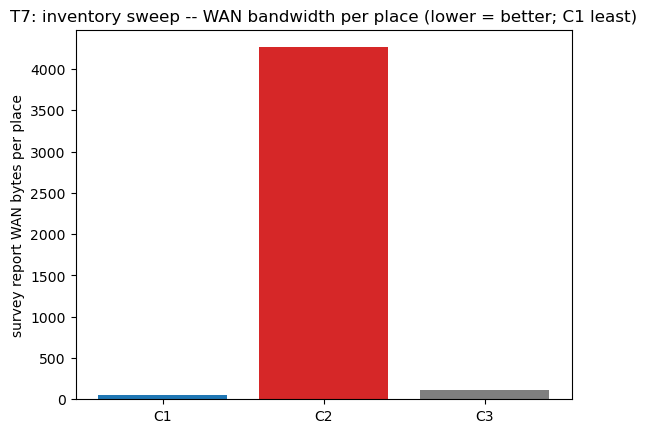

# T7: Inventory sweep -- survey idle pumps (WAN bandwidth)

- Trials: 3  |  generated 2026-11-07T16:24:12Z  |  commit a32c832
- Request: `Count the idle infusion pumps.`

## Scenario

- A real **survey** (inventory sweep of idle infusion pumps) planned by the cloud and executed by the **kinematic** edge (`edge_sim`, unmodified).
- **Metric: WAN bandwidth** = bytes the edge must send to report the sweep.

## Expected contrast (C1 least -- the edge filters)

- **C1 (edge SLM)**: analyses observations locally, ships a compact **filtered digest** -> **least** WAN.
- **C2 (cloud relay)**: no edge brain, ships **raw observations** (frames + sensor dumps) -> **most** WAN.
- **C3 (classical edge)**: ships **structured counts** (a row per place) -> in between.

The deployed cloud may split the sweep across clusters (different place counts per config), so **WAN bytes per place** is the fair headline metric; `wan_bytes` is the total for the places that config's sweep actually covered.

## Scope & honesty

- Scoped to **T7 only**: `scripts/edge_sim.py` and all shared files are unchanged.
- Only **standard** survey requests/execution are sent to the deployed cloud; the per-config report payload is **measured in the harness** (its serialized size), never posted as custom data the cloud might reject.
- C1/C2 use the **deployed** endpoints; C3 a local classical cloud.

A real survey (inventory sweep) planned by the cloud and executed by the kinematic edge (edge_sim, unmodified). WAN metric = the serialized size of the survey report each edge type would transmit: C1 ships an edge-filtered digest (least), C2 ships raw observations (most), C3 ships structured counts (between). Scoped to T7 only: no shared files changed. Only standard survey requests/execution are sent to the deployed cloud -- the per-config report size is measured in the harness, not posted as custom data. C1/C2 use the deployed endpoints; C3 local.

## Plots

## Results (per trial)

| mode | cloud | places | report kind | WAN bytes | bytes/place | survey status |
|---|---|---|---|---|---|---|
| C1 | deployed | 3 | edge_filtered_digest | 148 | 49.3 | completed |
| C2 | deployed | 3 | raw_observations | 12791 | 4263.7 | completed |
| C3 | local | 3 | structured_counts | 322 | 107.3 | completed |

Raw per-trial records are in `raw/trials.jsonl`; per-config report sizes in `raw/reports.jsonl`.
